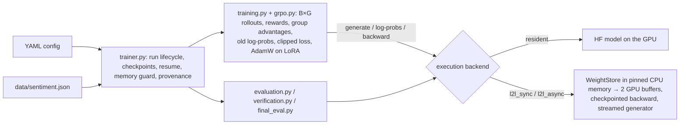

# qwen-grpo

GRPO + LoRA fine-tuning of Qwen3 in non-thinking mode, without an SFT stage, written by hand and checked numerically.
The task is binary sentiment classification on Rotten Tomatoes. The reward is 1 if the completion is exactly the
correct label, else 0.

## Research question

Qwen3-4B's bf16 weights alone are ~7.5 GiB, so under the assignment's 8 GB GPU cap (CUDA context included) the model
cannot stay on the GPU. The same GRPO optimizer therefore runs on interchangeable **execution backends**:

- **resident:** the whole model on the GPU, the numerical reference;
- **L2L ("layer-to-layer"):** frozen decoder weights in CPU memory, streamed through a bounded set of GPU buffers.

The questions are whether L2L changes the training at all (it should not: equality is tested bitwise), what it costs
(time, host RAM, transfers), and whether the complete Qwen3-4B system fits 8 GB and learns. They are stated as
hypotheses H01–H12 in [`research/l2l/hypotheses.yaml`](research/l2l/hypotheses.yaml), with thresholds fixed in advance
in [`tolerances.yaml`](research/l2l/tolerances.yaml) and the method in [`protocol.md`](research/l2l/protocol.md).

- **Qwen3-0.6B** is the development model.
- **Qwen3-4B** is the assignment model; **Kaggle's T4** is preliminary hardware (no native bf16).
- **Resident Qwen3-4B** is not expected to meet the strict 8 GB cap (estimated peak ~9.5 GiB, unmeasured); **L2L** is
  the memory-constrained strategy.
- **DFlash** is an optional, separately tested rollout strategy (off in the final run until H10 is measured).

## Architecture



There is **one** training loop. A backend (`qwen_grpo/execution/backend.py`, `make_backend()`) supplies only
`generate_rollouts`, `logprobs` and the greedy evaluation generator; the dataset, prompt and non-thinking template,
reward, advantages, clipping, LoRA targets and initialization, optimizer, micro-batching, metrics and checkpoints are
shared code.

| | resident | l2l_sync | l2l_async |
|---|---|---|---|
| frozen decoder weights | GPU | CPU store (pinned), copied into one of 2 GPU buffers when needed | same, next layer prefetched on a separate CUDA stream |
| rollouts | HF `generate` | streamed generator, KV cache on the GPU | same |
| backward | autograd | layer-boundary checkpoints, layers re-streamed and recomputed | same, reverse-order prefetch |
| LoRA, optimizer, embedding/head | GPU | GPU | GPU |

Async correctness rests on CUDA events guarding buffer ownership (a fault-injection run reuses a buffer unsafely and
must be caught). Nothing silently falls back: unimplemented settings (`resident_layers > 0`, `vocab_chunk_size`,
`activation_checkpointing: false`, DFlash under resident) are refused, and a GPU without kernels or native bf16 is
refused rather than switched to another precision or device. Details: [`docs/architecture.md`](docs/architecture.md).

Also implemented (optional): disk-backed prompt/rollout streaming with crash-consistent checkpoints and deterministic
resume (`streaming.enabled`), DFlash-drafted rollouts verified by the current LoRA policy (`dflash.enabled`), and a
tensor-by-tensor LoRA merge that never holds the full model (`qwen_grpo/export/merge.py`).

## Installation

```bash
python3.12 -m venv .venv && source .venv/bin/activate
pip install torch==2.14.1 --index-url https://download.pytorch.org/whl/cu126   # the build the lab fixtures were made with
pip install -r requirements.txt
```

The lab cases refuse other package versions (their saved fixtures are bitwise references); a GPU needs kernels in the
installed torch build (`python scripts/experiment.py plan --target local` checks this).

## Configuration

One schema, strictly validated (unknown keys, wrong types and unimplemented combinations are errors), layered with
`extends:`. Each run saves its fully resolved config with its sha256.

```
configs/profiles/shared.yaml      abstract: data, GRPO, LoRA rank, evaluation (shared by every model)
configs/profiles/qwen3_0_6b.yaml  Qwen3-0.6B, resident        configs/profiles/qwen3_4b.yaml  Qwen3-4B, L2L async, 8 GiB guard
configs/experiments/              runnable experiments (below)
configs/historical/               configs of recorded runs (H05 evidence), kept to reproduce them
configs/studies/assignment.yaml   which experiment tests which hypothesis (scripts/experiment.py)
configs/qwen.yaml                 the reference run runs/qwen (= the 0.6B profile)
```

| purpose | config | precision |
|---|---|---|
| 0.6B resident / L2L sync / L2L async (100 steps) | `qwen3_0.6b_resident.yaml`, `qwen3_0.6b_l2l_sync.yaml`, `qwen3_0.6b_l2l_async.yaml` | bf16 |
| 0.6B L2L async + disk streaming (10 steps) | `qwen3_0.6b_streaming.yaml` | bf16 |
| 0.6B on a Kaggle T4 (8 steps), the three backends + streaming | `kaggle_06b_fp32_{resident,l2l_sync,l2l_async,streaming}.yaml` | **float32 diagnostic** |
| 4B L2L async (H11) / sync / resident reference | `qwen3_4b_l2l.yaml`, `qwen3_4b_l2l_sync.yaml`, `qwen3_4b_resident.yaml` | bf16 |
| 4B smoke (4 steps, final batch shape), with DFlash | `qwen3_4b_smoke.yaml`, `qwen3_4b_smoke_dflash.yaml` | bf16 |
| 4B final run / LR=0 control / DFlash | `qwen3_4b_final.yaml`, `qwen3_4b_final_lr0.yaml`, `qwen3_4b_l2l_dflash.yaml` | bf16 |

Within each comparison the configs differ only in `execution` and `run.name` (pinned by `tests/test_profiles.py`),
so the backends see identical weights, LoRA initialization, samples, seeds, GRPO and sampling settings, precision and
optimizer. float32 appears only in the `kaggle_06b_fp32_*` files, which say so. Moving to 4B changes the model, the
LoRA module selection (`last2-attention` → q/v/o of the last two layers), the backend, the budget and the guard; the
GRPO settings are the 0.6B ones unchanged, and whether they suit 4B is open (not tuned). Guide:
[`docs/configuration.md`](docs/configuration.md).

## Running

```bash
python scripts/run.py train --config configs/experiments/qwen3_0.6b_resident.yaml   # resident GRPO
python scripts/run.py train --config configs/experiments/qwen3_0.6b_l2l_sync.yaml   # same run through L2L
python scripts/run.py train --config configs/experiments/qwen3_0.6b_l2l_async.yaml
python scripts/compare_runs.py qwen3_0.6b_resident qwen3_0.6b_l2l_sync              # every difference, exit 0 iff none

python scripts/run.py train --config runs/<run>/config.yaml --resume latest          # streaming runs (else --resume <checkpoint>)
python scripts/run.py validate --run <run>        # validation split through the run's backend
python scripts/run.py test     --run <run>        # test split (final report only)
python scripts/run.py verify   --run <run> [--control <lr0 run>]   # base / adapter / merged / LR=0 control
```

Outputs go to `runs/<run.name>/` (config, manifest, per-step log, checkpoints, evaluations); `train` refuses an existing
name. `validate`, `test` and `verify` execute the model through the backend its config selects: an L2L run is never
loaded whole onto the GPU. `verify` of a resident run uses `qwen_grpo/verification.py` (PEFT merge, validation split);
of an L2L run, `scripts/final_eval.py` (streamed merge, test split).

**Comparing backends.** `compare_runs.py` checks that the two configs differ only in run/execution/memory, then compares
every per-step quantity the trainer records (rollout token hash and texts, rewards, loss, clipping statistics,
gradient and update norms, adapter norms), subset predictions, every checkpoint's LoRA tensors and AdamW state, final
validation predictions and label scores, frozen-weight digests and, for streaming runs, every rollout record
(tokens, rewards, advantages, old log-probs). The rule is `tolerances.yaml` `update_equivalence`, which is 0 for both
L2L backends: bitwise equality. Per-token log-probs and gradient tensors are not recorded, so they are not compared
(the report lists its coverage). Runtime and memory are reported separately and never enter the verdict. Bitwise
equality is expected on the same machine and software only.

## Hypotheses

```bash
python scripts/experiment.py plan [--target local|kaggle-cpu|kaggle-t4|ampere]   # what can run where, and why not
python scripts/experiment.py run --hypothesis H05 [--entry H05.real_0.6b_bf16] [--again] [--dry-run]
python scripts/experiment.py report      # evidence/study_report.md + research/l2l/final_report.md
```

`configs/studies/assignment.yaml` maps every hypothesis to existing tools (`scripts/l2l_lab.py`,
`scripts/run.py`, `compare_runs.py`, `resume_experiment.py`, `profile_run.py`, `dflash_bench.py`, `final_eval.py`)
with the hardware, precision and prerequisites each needs. The dispatcher only runs them and reads their verdicts:
unmet hardware or a missing prerequisite run is BLOCKED (recorded, never PASS), existing evidence is never re-run or
overwritten, and `hypotheses.yaml` statuses change only by hand, citing evidence.

| | hypothesis | recorded status | evidence | gap |
|---|---|---|---|---|
| H01 | L2L forward = resident | SUPPORTED | tiny models, CPU + CUDA | async on CUDA; CUDA evidence predates later executor changes |
| H02 | checkpointed backward = resident LoRA gradients | SUPPORTED | tiny, CPU + CUDA; one real 0.6B step bitwise | same |
| H03 | memory-efficient output head | SUPPORTED (v2) | tiny, CPU only; v1 stays NOT_SUPPORTED (power-rule design flaw, fixed in 5300146) | GPU; the chunked head is not used in training |
| H04 | streamed generation = resident | SUPPORTED | tiny, CPU + CUDA; real 0.6B rollouts equal | async on CUDA |
| H05 | complete update = resident | SUPPORTED | tiny CPU + CUDA; two 0.6B training runs (10 and 100 steps) bitwise identical on CUDA | async; current code on a bf16 GPU |
| H06 | async prefetch faster, results unchanged | untested | — | Ampere GPU |
| H07 | bounded GPU weight residency | SUPPORTED (Ticket 02 copy-only statement) | allocator statistics, copy-only | execution-level case `t11_depth_residency` untested |
| H08 | crash + resume = uninterrupted | SUPPORTED | tiny, CPU, six crash points | real 0.6B run |
| H09 | streamed merge preserves behaviour | untested | tiny fp32/bf16 variants PASS | real 0.6B variant (criterion needs all) |
| H10 | DFlash faster and on-policy | untested | CPU exactness tests only | Qwen3-4B on a GPU |
| H11 | Qwen3-4B within 8 GB | untested | budget estimates only (not evidence) | assignment-grade run (native Linux, per-process nvidia-smi) |
| H12 | held-out learning vs base and LR=0 control | untested | — (0.6B: see below) | the final 4B run |

The Qwen3-0.6B reference run (`runs/qwen`, resident, one seed, checkpoint chosen on validation) improved test accuracy
from 0.7326 to 0.7964 (paired bootstrap 95% CI of the difference [+0.042, +0.085]; validation 0.7486 → 0.8096). This is
development evidence on the small model, not H12.

## Kaggle (free preliminary runs)

```bash
python scripts/kaggle_submit.py submit --mode cpu        # CPU tests, GPU hidden
python scripts/kaggle_submit.py submit --mode gpu-tests  # CUDA tests on tiny models (CUDA × bf16 items skipped on the T4)
python scripts/kaggle_submit.py submit --mode gpu-short  # 0.6B fp32: resident vs L2L sync vs L2L async + comparisons
python scripts/kaggle_submit.py status|download|summary --mode <mode>
```

Each kernel clones the repository at a pinned commit that must already be on GitHub, records its environment, runs,
and writes raw evidence; a step that needs bf16 is SKIPPED with its reason, never counted as passed. See
[`kaggle/README.md`](kaggle/README.md). Only after the 0.6B evidence is in should Qwen3-4B run on a rented GPU
([`docs/deployment.md`](docs/deployment.md)).

## Evidence and reporting

| what | where |
|---|---|
| hypotheses, tolerances, protocol | `research/l2l/` |
| raw lab results (never overwritten; large ones stored as lossless `result.json.gz`) | `research/l2l/experiments/` |
| index of every recorded output: sha256, statuses, provenance, citing hypotheses | `research/l2l/evidence_index.json` |
| dispatcher executions: manifest (commit, dirty tree, hardware, configs + sha256, seeds, commands, UTC times), raw logs, nvidia-smi samples, results | `evidence/<UTC>_<entry>/` |
| requirement statuses and verdict derived from the evidence | `research/l2l/final_report.md` |
| training runs (not committed) | `runs/<run>/` |

Memory: the per-step allocator figures (`peak_reserved_gib`) exclude the CUDA context and are never budget evidence.
The 8 GB claim needs `memory.guard` samples from `nvidia-smi` listing the process itself, on native Linux
(`research/l2l/protocol.md`, "Memory evidence").

## Tests

```bash
CUDA_VISIBLE_DEVICES="" python -m pytest -q        # full CPU suite (~11 min); never loads pretrained weights
python -m pytest -q tests/test_prefetch.py tests/test_backward.py tests/test_generator.py tests/test_layer_stream.py \
  tests/test_backend.py tests/test_output_head.py tests/test_weight_store.py tests/test_dflash.py   # CUDA variants
QWEN_GRPO_ARCHIVE=<extracted archive>/repo python -m pytest -q tests/test_historical.py  # archived reference-run checks
```

Tests fail if they modify `runs/`, `results/` or `checkpoints/`.

## Known limitations

- **No Qwen3-4B GPU evidence yet:** the 8 GB budget, L2L at 4B, DFlash, the merge at scale and held-out learning (H06,
  H09–H12) are unmeasured. The verdict derived from the evidence is DON'T SHIP until they are.
- **The CUDA equivalence evidence predates later executor changes** (`research/l2l/final_report.md`, "Evidence
  freshness"): re-run `H01.lab_sync`, `H02.lab_sync_cuda`, `H04.lab_sync_cuda`, `H05.lab_sync_cuda` with `--again`.
- **The saved lab fixtures do not record the CPU they were built on**, so their CPU-bitwise reference is trusted on
  no host; the test suite builds fixtures in-session instead, and the saved-artifact tests skip.
- **H03 is supported on CPU with tiny models only** and the chunked head stays disabled for training.
- **bf16 results depend on GPU and batch shape:** resident vs L2L identity is established per machine.
- **The task is easy for the base model** (0.6B already scores ~0.73–0.75), which leaves less room to show learning;
  no forgetting benchmark is evaluated.
- **DFlash in the final run is an open decision:** with 4-token rollouts at most 3 drafted tokens can be accepted.

History, per-ticket design notes and the correctness audit: [`docs/development_history.md`](docs/development_history.md),
[`docs/l2l/`](docs/l2l/), [`docs/correctness_audit.md`](docs/correctness_audit.md). What this cleanup moved and why:
[`docs/cleanup_report.md`](docs/cleanup_report.md).
