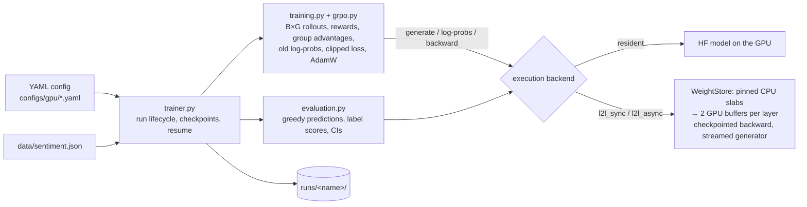

# qwen-grpo

GRPO + LoRA fine-tuning of Qwen3 (non-thinking mode, no SFT stage), written by hand and checked numerically. The task
is Rotten Tomatoes sentiment classification with an automatic exact-label reward.

**Why it exists.** Qwen3-4B's bf16 weights alone are ~7.5 GiB, so with an 8 GiB GPU cap the model cannot stay on the
GPU. The same GRPO optimizer therefore runs on two execution backends, selected in YAML:
- **resident:** the whole model on the GPU;
- **L2L:** frozen decoder layers in pinned CPU memory, streamed layer by layer to the GPU for generation, forward and
  checkpointed backward. Synchronous, or with asynchronous prefetching.

The research question is what L2L costs (time, host RAM, PCIe traffic), and whether it changes the training at all.

| you want to | run | hardware |
|---|---|---|
| train Qwen3-0.6B, model on the GPU | `python scripts/run.py train --config configs/gpu/qwen3_0.6b_resident.yaml` | CUDA GPU ≥ 4 GB |
| the same through L2L (sync / async) | `... --config configs/gpu/qwen3_0.6b_l2l_sync.yaml` / `qwen3_0.6b_l2l_async.yaml` | CUDA GPU ≥ 4 GB, ≥ 16 GB RAM |
| Qwen3-4B, model on the GPU (reference) | `... --config configs/gpu/qwen3_4b_resident.yaml` | CUDA GPU ≥ 16 GB |
| Qwen3-4B through L2L, 8 GiB target | `... --config configs/gpu/qwen3_4b_l2l_async.yaml` (or `_l2l_sync`) | CUDA GPU ≥ 8 GB, ≥ 32 GB RAM |

Every run writes to `runs/<run.name>/`: `report.md`, `training/training.json` (per-step log and timings), checkpoints
and evaluations. Bf16 needs a GPU that supports it (compute capability ≥ 8.0 recommended); the run refuses to start
otherwise rather than switching precision or device.

## Status

| component | implemented | CPU tests (tiny models) | GPU evidence |
|---|---|---|---|
| resident GRPO + LoRA | IMPLEMENTED | TESTED | TESTED: Qwen3-0.6B, 100 steps (`runs/qwen`: val. accuracy 0.7486 → 0.8096) |
| L2L synchronous | IMPLEMENTED | TESTED: bitwise = resident (forward, gradients, generation, updates, whole runs) | TESTED on tiny models and a Qwen3-0.6B run identical to resident; this evidence predates later executor changes. Qwen3-4B UNTESTED |
| L2L asynchronous prefetch | IMPLEMENTED | TESTED: = sync, unsafe buffer reuse caught | UNTESTED |
| disk streaming + crash-consistent resume (optional) | IMPLEMENTED | TESTED: 6 crash points, bitwise resume | UNTESTED |
| streamed LoRA merge (CPU) | IMPLEMENTED | TESTED | UNTESTED on a real model |
| DFlash rollouts (optional, off) | IMPLEMENTED | TESTED: greedy equality, sampling law | UNTESTED |
| chunked-vocabulary output head | IMPLEMENTED | TESTED (H03 v2) | BLOCKED for training: refused by config |
| GPU memory guard (nvidia-smi) | IMPLEMENTED | TESTED with injected samples | UNTESTED |

Assignment verdict, derived from the evidence: **DON'T SHIP**. 6 of 15 requirements PASS; every remaining one needs a
GPU run (`research/l2l/final_report.md`). Audit, open decisions and limitations are in
[`docs/status.md`](docs/status.md).

## Architecture



The GRPO objective lives in `grpo.py` / `training.py` and is identical for every backend. A backend supplies only
`generate_rollouts`, `logprobs` and the greedy evaluation generator (`qwen_grpo/execution/backend.py`); there is no
second training loop. Details: [`docs/architecture.md`](docs/architecture.md).

## Setup (Linux, CUDA)

```bash
git clone --branch feat/l2l-streaming-research https://github.com/trulyaldi/qwen-grpo.git && cd qwen-grpo
python3 -m venv .venv && source .venv/bin/activate        # Python 3.12
pip install torch==2.14.1 --index-url https://download.pytorch.org/whl/cu126   # pick the cuXXX matching `nvidia-smi`
pip install -r requirements.txt                           # the other pinned packages (torch already satisfied)
pip install -e . --no-deps                                # optional: the `qwen-grpo` command
python -c "import torch; print(torch.__version__, torch.cuda.is_available(), torch.cuda.get_device_name())"
```

Models download from the Hugging Face Hub on first use: Qwen3-0.6B is ~1.5 GB and Qwen3-4B ~8 GB. Set `HF_HOME` to
keep the cache on a persistent disk.

## Tests

```bash
CUDA_VISIBLE_DEVICES="" python -m pytest -q          # full CPU suite, ~10 min; never loads real weights
python -m pytest -q tests/test_prefetch.py tests/test_backward.py tests/test_generator.py tests/test_layer_stream.py \
  tests/test_backend.py tests/test_output_head.py tests/test_weight_store.py    # CUDA variants (tiny models), needs a GPU
```

Tests fail if they modify `runs/`, `results/` or `checkpoints/`.

## Training

```bash
python scripts/run.py train --config configs/gpu/qwen3_0.6b_resident.yaml
python scripts/run.py train --config configs/gpu/qwen3_0.6b_l2l_sync.yaml
python scripts/run.py train --config configs/gpu/qwen3_0.6b_l2l_async.yaml
```

- **Run names.** `train` refuses a `run.name` that already has a directory; set `run.overwrite: true` to replace it.
- **Status.** A run ends as `completed`, `failed` (an exception, a GPU-memory budget violation, changed frozen
  weights) or `interrupted`.
- **Gated alternative.** `qwen-grpo train --config ...` runs the same trainer, but first runs a preflight and refuses
  configs that cannot work.

**Resume** from a checkpoint the run saved (every `evaluation.every` steps). The result equals the uninterrupted run
bitwise on CPU (tested):

```bash
ls runs/qwen3_0.6b_l2l_async/checkpoints/                       # step0 step10 step20 ...
python scripts/run.py train --config runs/qwen3_0.6b_l2l_async/config.yaml \
  --resume runs/qwen3_0.6b_l2l_async/checkpoints/step20
```

Configs with `streaming.enabled` (disk-backed prompts and rollouts) also accept `--resume latest`: the highest-step
checkpoint that validates. `qwen-grpo resume --run <name>` picks the right form automatically.

## Evaluation and comparison

```bash
python scripts/run.py validate --run qwen3_0.6b_l2l_async     # validation split, latest checkpoint, through the run's backend
python scripts/run.py test     --run qwen3_0.6b_l2l_async     # test split: keep for the final report
python scripts/run.py verify   --run qwen3_0.6b_resident      # base / adapter / merged / LR=0 checks (resident runs only)
python scripts/final_eval.py   --run qwen3_4b_l2l_async [--control <lr0 run>]   # the same four models for any backend, test split
python scripts/compare_runs.py qwen3_0.6b_resident qwen3_0.6b_l2l_sync          # step-by-step and checkpoint diff
```

- **`validate` and `test`.** They run through the backend the run's config selects; DFlash is never used for
  evaluation. They record accuracy, macro F1, per-class recall, invalid rate, positive-prediction rate and ROC AUC,
  with paired bootstrap CIs against the base model, aligned by example id.
- **`verify`.** It is resident-only, because it builds PEFT merges and an fp32 copy of the whole model. For an L2L run
  it refuses and names `final_eval.py`.
- **`compare_runs.py`.** It reports every difference (rollouts, losses, gradients, adapters, optimizer state). Equal
  numbers are expected only for runs on the same machine and software.

## Memory and performance

- **Per step** (`training/training.json`), every run records:
  - in `training`: allocator allocated / peak allocated / peak reserved;
  - in `timings`: rollout, old-log-prob and update seconds, rollout tokens, CPU RSS, and the weight bytes copied
    host → GPU (L2L; `null` for resident).
- **With `memory.guard`** (on in the Qwen3-4B configs): raw `nvidia-smi` and `cudaMemGetInfo` samples, CUDA context
  included, go to `training/memory/`, and the run stops at the first sample above `run.gpu_budget_gib`.
- **Allocator figures are never budget evidence.** They exclude the CUDA context.
- **Profiling and estimates:**
  - `scripts/profile_run.py --config <l2l yaml>` profiles every phase (rollout, old log-probs, forward, backward,
    optimizer, merge, evaluation) with measured H2D bandwidth;
  - `qwen-grpo preflight --config <yaml>` gives memory and transfer *estimates* before any GPU work.

No performance number is claimed here: prefetching, L2L overhead and the 8 GiB fit are open measurements.

## Configuration

- **Layout.** `configs/profiles/shared.yaml` is the shared base (abstract, not runnable). Next to it are one profile
  per model (`qwen3_0_6b.yaml`, `qwen3_4b.yaml`), the canonical comparison configs in `configs/gpu/`, and older
  research configs in `configs/experiments/`, which are kept because their runs and evidence refer to them.
- **Inheritance.** A config names its parent with `extends:`.
- **Validation.** Unknown keys, wrong types and unsupported combinations are errors. `train` refuses settings that are
  implemented but not usable, such as `vocab_chunk_size`, resident layers > 0, or DFlash with the resident backend,
  rather than falling back.

Full guide: [`docs/configuration.md`](docs/configuration.md).

## Repository

```
qwen_grpo/            implementation: grpo, training, trainer, model, sentiment, evaluation, verification, reporting
  execution/          backends: resident | L2L (weight store, layer streaming, checkpointed backward, prefetch,
                      generator, output head, DFlash), profiler
  streaming/  export/ disk-backed prompts/rollouts + resume; streamed LoRA merge
  budget/  diagnostics/  integrations/   memory/PCIe calculator; preflight and silent-failure checks; optional Soup
  *_lab.py, lab.py    research lab cases (not imported by training)
configs/              profiles/, gpu/ (canonical), experiments/ (historical/research), budget/
scripts/              run.py (train/validate/test/verify/report/remove), final_eval.py, compare_runs.py, profile_run.py,
                      merge.py, l2l_lab.py, dflash_bench.py, ...
tests/                CPU correctness and regression tests (+ CUDA variants)
docs/                 architecture, configuration, deployment (remote GPU), status, silent failures; docs/l2l/ per ticket
research/l2l/         hypotheses, protocol, tolerances, runbook, raw evidence; research/soup/ Soup diagnostics
runs/  results/       generated outputs (runs/ is git-ignored except the reference run runs/qwen); shared baselines
```

## Further reading

- [Remote GPU workflow](docs/deployment.md): what to run after connecting to a rented Linux GPU.
- [Implementation status and limitations](docs/status.md), and [silent failures](docs/silent_failures.md).
- [Development history](docs/development_history.md): tickets 00–13, with the per-ticket notes in `docs/l2l/`.
- [Research protocol](research/l2l/protocol.md): hypotheses `research/l2l/hypotheses.yaml`, evidence
  `research/l2l/experiments/`.
