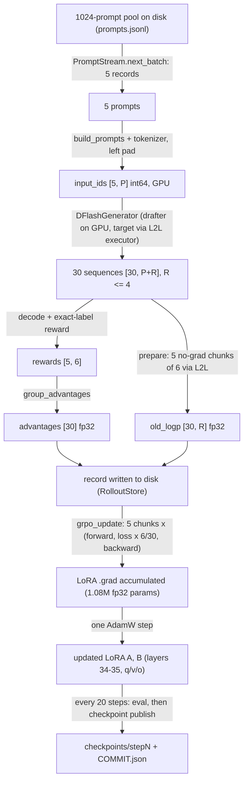

# 00 — Reading map: the whole system on one page

**What you will be able to explain after this file**
- The single path that five training prompts take through the system, and which document covers each hop.
- Which statements in this document set are verified by code, by tests, by measurement, or only predicted.
- Which parts of the repository you can safely ignore in an interview, and which you must know cold.

> [!IMPORTANT]
> These documents describe the **working tree of 2026-11-18** (`main` @ `e8440e4` plus uncommitted changes):
> - the H02 buffer-ownership correction in `qwen_grpo/execution/prefetch.py` (`BufferReuseError`, `_claim`);
> - the Qwen3-4B hyperparameter update in `configs/experiments/qwen3_4b_final.yaml` (micro-batch 6, lr 2e-4, evaluate every 20, eval batch 16).
>
> Committed `HEAD` still has `micro_batch_size: null` (30 rows in one chunk), lr 5e-4, evaluation every 10, eval batch 32.

## Evidence labels used throughout

| Label | Meaning |
|---|---|
| **[code]** | Read in the source; describes what the program does |
| **[test]** | A named pytest checks it (usually tiny random models, CPU; CUDA variants exist but skip on this host) |
| **[measured]** | A recorded run or lab result exists (file cited) |
| **[predicted]** | Budget calculator or arithmetic only |
| **[unverified]** | Nobody has checked it; the experiment that would settle it is named |

There is **no Qwen3-4B GPU measurement of any kind** yet. Every 4B memory or time number is **[predicted]**.

## The whiteboard path (one rollout batch of the final run)

Each hop, with the document that explains it:

| # | Hop | Main code | Read |
|---|---|---|---|
| 1 | Pool → 5 prompts (deterministic, resumable) | `streaming/dataset.py` `PromptStream` | 01, 12 |
| 2 | Text → token ids, masks, positions | `sentiment.build_prompts`, `policy.generate_rollouts` | 01 |
| 3 | 5 prompts → 30 completions (G = 6 copies each, prompt-major rows) | `policy.generate_rollouts` → `DFlashGenerator` / `StreamedGenerator` | 01, 08 |
| 4 | Every target forward: 36 decoder layers streamed CPU → GPU | `execution/weight_store.py`, `layer_stream.py`, `prefetch.py` | 04, 05 |
| 5 | Reward, group advantages, zero-signal skip | `training.group_rewards`, `grpo.group_advantages`, `training.prepare` | 02, 07 |
| 6 | Old log-probs (no grad), then 5 micro-batches of 6 with grad | `training.prepare`, `training.grpo_update`, `output_head.streamed_logprobs` | 01, 02 |
| 7 | Backward without the weights kept on GPU: recompute layers 34–35 only | `execution/backward.py` `_CheckpointedLayer` | 06 |
| 8 | LoRA gradients → one AdamW step | PEFT LoRA, `torch.optim.AdamW` | 06, 07 |
| 9 | Evaluation, checkpoint publication, resume | `trainer.save`, `streaming/resume.py`, `checkpointing.py` | 02, 12 |
| 10 | Memory bound (8e9 B) and how it is enforced and measured | `budget/`, `execution/profiler.py`, `telemetry.py` | 09, 13 |

## Recommended reading order

1. [01-batches-groups-microbatches.md](01-batches-groups-microbatches.md): the vocabulary everything else depends on (B, G, N = 30, micro-batch 6, one update).
2. [02-grpo-complete-step.md](02-grpo-complete-step.md): one continuous worked iteration.
3. [07-grpo-mathematics.md](07-grpo-mathematics.md): why the loss looks the way it does, and what `num_iterations = 1` implies.
4. [03-qwen3-forward.md](03-qwen3-forward.md): what one decoder layer computes.
5. [04-l2l-weight-streaming.md](04-l2l-weight-streaming.md), then [05-cuda-prefetch-and-buffer-safety.md](05-cuda-prefetch-and-buffer-safety.md): where weights live, how they move, why it is safe (and where it was not).
6. [06-checkpointed-backward.md](06-checkpointed-backward.md): correct gradients without resident weights.
7. [08-dflash-integration.md](08-dflash-integration.md): speculative rollouts on top of the L2L target.
8. [09-memory-and-tensor-lifetimes.md](09-memory-and-tensor-lifetimes.md): byte-level accounting.
9. [10-hyperparameters.md](10-hyperparameters.md): every knob, what it does in the code.
10. [12-streaming-and-resume.md](12-streaming-and-resume.md): deterministic resume.
11. [11-research-hypotheses.md](11-research-hypotheses.md), [13-orchestration-and-evidence.md](13-orchestration-and-evidence.md): the research program, the evidence and its gaps.
12. [14-interview-defense.md](14-interview-defense.md): hard questions, with honest answers.
13. [whimsical-diagrams.md](whimsical-diagrams.md): 15 diagram specs to redraw.

## What to know cold vs. what you can skip

**Know cold (about 2,000 lines of code)**

| Area | Files |
|---|---|
| Training loop | `qwen_grpo/trainer.py` `_train` |
| GRPO mechanics and math | `qwen_grpo/training.py`, `qwen_grpo/grpo.py`, `qwen_grpo/policy.py` |
| Task and reward | `qwen_grpo/sentiment.py` |
| L2L engine | `qwen_grpo/execution/{backend,weight_store,layer_stream,qwen3_forward,backward,prefetch,generator,output_head,dflash}.py` |
| Disk streaming | `qwen_grpo/streaming/` |

**Know what it is for, not line by line**

| Area | Files |
|---|---|
| Budget calculator | `qwen_grpo/budget/` |
| Profiler, telemetry | `qwen_grpo/execution/profiler.py`, `qwen_grpo/telemetry.py` |
| Merge | `qwen_grpo/export/merge.py` |
| Evaluation | `qwen_grpo/evaluation.py`, `scripts/final_eval.py` |

**Infrastructure, about 6,000 lines.** Lab harnesses (`qwen_grpo/*_lab.py`, `lab.py`), the orchestrator and report (`scripts/assignment*.py`), Kaggle tooling. Be able to say what they guarantee (see 13), not how.

## The five facts most likely to be probed, and where the code disagrees with intuition

1. **One update per rollout batch.**
   - The 30 completions are split into 5 micro-batches of 6 only to bound activation memory. The gradient is mathematically the full-batch gradient (01, 07).
   - Cost: the engine is **micro-batch-major**, so each micro-batch streams all 36 layers again. That is 5 full weight sweeps for old log-probs and 5 for the update (01, 04).
   - The L2L paper's layer-major loop, which would avoid this, is **not implemented**.
2. **The PPO clip never binds in this configuration.**
   - With `num_iterations: 1` the only update happens at ratio exactly 1. The gradient equals a length-normalized REINFORCE with a group-mean baseline, scaled by 1/std (07).
3. **Backward recomputes only layers 34–35, and with two buffers it copies no weights at all.**
   - LoRA sits only there, so layers 0–33 build no autograd node and are never re-streamed in backward (06).
   - In a grad pass the prefetcher stops after layer 35, so layers 34 and 35 are still in the two buffers when backward starts: both recomputations are buffer hits. Verified by running the executor's ownership logic on a tiny 6-layer model on CPU (`stats`: 28 uses, 27 hits, 1 on-demand copy) **[code]**. The budget calculator assumes the opposite (2 layers reloaded per micro-batch, 2.019 GB per step), so its transfer estimate is slightly high (05, 09).
   - This is also why the H02 fault corrupted gradients *silently* for layers below 34 (05).
4. **DFlash only changes how rollout tokens are produced.**
   - Old log-probs, the loss and evaluation never use the drafter (08).
   - With at most 4 new tokens, one verify pass can accept at most 3 drafts.
   - DFlash's prefill computes the LM head over every prompt position, which is the predicted memory peak (08, 09).
5. **Equivalence evidence is partial.**
   - Synchronous L2L equals the resident run bitwise on real Qwen3-0.6B for 10 and 100 steps **[measured]**.
   - Asynchronous L2L is equal only on tiny models on CPU **[test]**.
   - Nothing has run at 4B (11, 13).

## Weaknesses and contradictions found while writing these documents

None of these were fixed (the task was analysis only). Each is explained in the file named.

| # | finding | where it is explained |
|---|---|---|
| 1 | The in-process memory guard and allocator cap use **8 GiB = 8,589,934,592 B** (`trainer.py:408`, `414`). The strict **8,000,000,000 B** cap is enforced only by the orchestrator's external nvidia-smi watchdog (`qwen_grpo/telemetry.py`, `configs/studies/assignment.yaml` `gpu_memory_cap`). A run started directly with `scripts/run.py train` is guarded at 8 GiB only. The allocator cap also excludes the CUDA context. | 09, 14 |
| 2 | DFlash prefill applies the LM head to **every** prompt position of all 30 rows and upcasts to fp32 (`dflash.py:167`), although only the last column is used: ≈ 2.0 GB at P = 73, 2.5 GB at P = 93. This is the predicted peak of the whole run. | 08, 09 |
| 3 | The budget calculator assumes `pin_memory()` power-of-two rounding (+2.23 GiB host RAM), but the store pins exact-size allocations with `cudaHostRegister`; and it assumes backward reloads layers 34–35 (see fact 3 above). Its predictions are conservative relative to the code, not derived from it. | 04, 09 |
| 4 | `old_logp` is a teacher-forced recomputation, not the probability under which the tokens were sampled (KV-cached decode or DFlash block logits). `INIT_TOL` compares `old_logp` with the update's log-probs only. | 02, 07 |
| 5 | With `num_iterations: 1` the clip, `clip_eps` and the logged ratio/clip/KL statistics are all inert (ratio ≡ 1); the logs contain no measure of drift from the base policy. | 07 |
| 6 | Prompts are duplicated six times before prefill (`repeat_interleave`): six identical prompt computations and KV copies per prompt, no prefix sharing. | 01, 08 |
| 7 | With `num_iterations: 1`, `pending` is always `None` when a checkpoint is written, so the "resume in the middle of a rollout batch" path is never exercised by the final config. | 12 |
| 8 | The final config's hyperparameters (micro-batch 6, lr 2e-4, eval every 20, eval batch 16) are uncommitted working-tree edits. | 01, 10 |
| 9 | The corrected H02 ownership check (`_claim`) validates host-side bookkeeping; the byte-level buffer checksum (`verify=True`) is off in production; the corrected fault test has run on CPU only. | 05 |
| 10 | `scripts/assignment.py` (docstring and the experiment-mode gate) still treats `H02.fault_unsafe_reuse` as a known, WAIVED FAIL, which predates the `_claim` correction. | 05, 13 |
| 11 | The budget assumes a shard-sized temporary loading copy, but `model.lora_model` loads the **whole** model into pageable CPU RAM before the store adopts it; peak host RAM is unmeasured. | 04, 09 |
| 12 | Nothing calls `torch.cuda.empty_cache()`, so the ~2 GB DFlash prefill transient stays reserved: nvidia-smi should show roughly the rollout peak for the rest of the run **[predicted]**. | 09 |

## Open questions / unverified (system level)
- Whether the 4B system fits 8e9 bytes per nvidia-smi: run `H11.smoke`, `H10.smoke_dflash`, `H11.profile` on the target GPU.
- Whether async prefetch actually overlaps copy and compute on real hardware: `H06.prefetch_timing`.
- Whether async L2L equals resident on a real model under CUDA: `qwen3_0.6b_{resident,l2l_async}_short` plus `compare_runs.py`.
- Whether lr 2e-4 avoids the label collapse seen at 5e-4 on 0.6B: untested at any scale.
