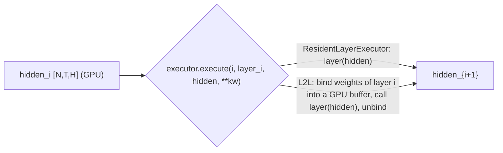

# 03 — The Qwen3-4B forward pass, as this repository executes it

**What you will be able to explain after this file**
- Every tensor operation of one Qwen3-4B decoder layer, with shapes, for a training micro-batch, a rollout prefill and a rollout decode step.
- Where the left-padding, the position ids, the causal mask and RoPE come from, and why two slightly different position conventions in the code are harmless.
- Why the LM head is applied to only `R + 1` columns, and why the column that predicts token `t` is column `t − 1`.
- Exactly where the LoRA adapters sit (q/v/o of layers 34–35), in what dtype they compute, and how their output is merged into the bf16 base path.
- Why L2L changes **no arithmetic**: it only wraps the call `layer(hidden, **kwargs)`.

Notation: `N` rows, `T` columns (= `P + R`), `H = 2560` hidden, `V = 151,936` vocabulary, `nh = 32` query heads, `nkv = 8` key/value heads, `d = 128` head dim, `I = 9728` MLP width, `L = 36` layers. Model config: `~/.cache/huggingface/hub/models--Qwen--Qwen3-4B/.../config.json` (`tie_word_embeddings: true`, `rms_norm_eps: 1e-6`, `rope_theta: 1e6`) **[code]**.

---

## 1. Intuition

A decoder-only transformer is a map from `T` token ids to `T` next-token distributions. Each of the 36 layers reads the whole residual stream `x ∈ R^{T×H}` per row and *adds* two corrections to it: an attention correction (mixes information across earlier positions) and an MLP correction (per-position nonlinearity). Normalization happens *before* each correction (pre-norm), so the residual stream itself is never normalized until the final norm.

The repository does not re-implement any of this arithmetic. `qwen_grpo/execution/qwen3_forward.py` calls Hugging Face's own modules one by one so that **the per-layer loop is ours** (`qwen3_forward.py:193-198`) and a layer executor can decide where a layer's weights live while it runs.

## 2. The explicit forward (`explicit_forward`, `qwen3_forward.py:167-204`)

```text
hidden  = embed_tokens(input_ids)                               [N, T, H]   bf16   (qwen3_forward.py:187)
masks   = create_causal_mask(...)                               None or [N, 1, T, T] (qwen3_forward.py:190, 155-164)
cos,sin = rotary_emb(hidden, position_ids)                      [N, T, d] each, bf16 (qwen3_forward.py:191)
for i in 0..35:
    hidden = executor.execute(i, layer_i, hidden,
                              attention_mask=masks[...], position_ids=..., position_embeddings=(cos, sin))
                                                                [N, T, H] -> [N, T, H]  (qwen3_forward.py:193-196)
hidden  = norm(hidden)                                          [N, T, H]   (qwen3_forward.py:200)
logits  = lm_head(hidden[:, -K:, :])                            [N, K, V]   (qwen3_forward.py:203-204)
```

It is a step-by-step reproduction of `Qwen3ForCausalLM.forward` for transformers 4.57 without a KV cache; the module docstring states the contract (`qwen3_forward.py:125-135`). The H01 lab case checks that this explicit loop equals HF's own forward **bitwise** before it compares L2L against it ("reference integrity", `research/l2l/hypotheses.yaml` H01) **[test]**.

### 2.1 Embedding

`embed_tokens` is an `nn.Embedding(151936, 2560)` in bf16: a row gather, `hidden[n, t, :] = E[input_ids[n, t], :]`. Size of `E`: 151,936 × 2,560 × 2 B = 777,912,320 B (741.9 MiB). It stays on the GPU for the whole run (`layer_stream.place_resident`, `layer_stream.py:31-45`; see 04-l2l-weight-streaming.md).

Because `tie_word_embeddings` is true, the LM head **is the same Parameter**: `lm_head.weight is embed_tokens.weight` — checked in `output_head.output_head` (`output_head.py:268-276`) **[code]**. One 742 MiB tensor serves both as the input lookup table and as the output projection.

### 2.2 Left padding, attention mask, and position ids

Prompts in a batch have different lengths. The tokenizer is created with `padding_side="left"` (`trainer.py:518`), so shorter prompts get pad ids (151643, `<|endoftext|>`) on the **left** and every prompt's last real token sits in the same final column `P − 1`. That alignment is what makes "the next generated token is appended at column `P`" true for every row.

Real example (first batch of the final run's sampler, Qwen3 tokenizer, computed offline in a scratch script): the 5 prompts have 51, 73, 55, 60, 65 real tokens, so `P = 73` and row 0 starts with 22 pad ids **[measured: tokenizer only, no model]**.

```text
row 0  ids : [151643 ×22, <|im_start|>, user, \n, Classify, ... , </think>, \n\n]     attention_mask: [0 ×22, 1 ×51]
       pos : [0 ×22, 0, 1, 2, ..., 50]                     (cumsum(mask) − 1, clamped at 0)
```

Two conventions exist in the code:

| where | formula | value on pad columns |
|---|---|---|
| `policy.compute_logprobs` (`policy.py:297`), `output_head.streamed_logprobs` (`output_head.py:294`) | `(mask.cumsum(1) − 1).clamp(min=0)` | 0 |
| `generator._positions` (`generator.py:73-76`), DFlash | `cumsum − 1`, then pad positions set to 1 (HF `prepare_inputs_for_generation`) | 1 |

**Why the difference is harmless.** A pad column's position only affects (a) the RoPE rotation of the pad column's own q and k, and (b) whatever the pad column's query computes. The 4D mask forbids every real query from attending to a pad key, so pad keys are never read by real tokens; pad queries produce outputs that nothing downstream reads (their logits are never scored: only the last `R + 1` columns go to the head, and the response is right of the prompt). Real columns get identical positions under both conventions. **[code]** reasoning; the H04 generation-equivalence case compares streamed generation against HF `generate()` with left-padded prompts and has a fault control (`fault_no_padding_mask`, `fault_stale_position`) that must and does fail when padding is mishandled **[test]**.

`create_causal_mask` (HF, called at `qwen3_forward.py:155-164`) returns `None` for an all-ones mask under SDPA (SDPA then uses its `is_causal` path) or a `[N, 1, T, T]` mask combining causality (`key ≤ query`) and padding (`key` not a pad column). For a micro-batch of 6 with `T = 77` that is 6 × 77 × 77 entries — tiny.

### 2.3 RoPE tables

`rotary_emb(hidden, position_ids)` (`modeling_qwen3.py:321-333`) computes, in fp32 with autocast disabled, `freqs[n, t, j] = position_ids[n, t] · θ^{−2j/d}` for `j < 64` with `θ = 10^6`, duplicates them to 128, and returns `cos`, `sin` cast to the activation dtype: `[N, T, 128]` each. These are computed **once per forward** and passed to every layer as `position_embeddings` (`qwen3_forward.py:194-195`); they do not require grad, which the checkpointed executor asserts (`backward.py:314-316`).

## 3. One decoder layer (`Qwen3DecoderLayer.forward`, `modeling_qwen3.py:246-279`)

Pre-norm residual block:

```text
r  = x                                            [N,T,H]
x  = input_layernorm(x)                           RMSNorm(H)
a  = self_attn(x, cos, sin, mask)                 [N,T,H]
x  = r + a
r  = x
x  = post_attention_layernorm(x)                  RMSNorm(H)
x  = r + mlp(x)                                   [N,T,H]
```

### 3.1 RMSNorm (`modeling_qwen3.py:59-64`)

`y = w ⊙ bf16( x_fp32 / sqrt(mean(x_fp32²) + 1e-6) )`. The square-mean is done in fp32, the normalized vector is cast back to bf16, then multiplied by the learned bf16 weight `w ∈ R^H`. No mean subtraction (that is the difference from LayerNorm). Parameters: 2,560 per norm.

### 3.2 Attention (`Qwen3Attention.forward`, `modeling_qwen3.py:188-231`)

| step | operation | shape (training micro-batch, n = 6, T = 77) |
|---|---|---|
| q | `q_proj(x)` : W_q ∈ R^{4096×2560} | [6, 77, 4096] → view [6, 77, 32, 128] |
| q_norm | **per-head RMSNorm over the 128-dim head** (Qwen3-specific; `modeling_qwen3.py:183`) | [6, 77, 32, 128] → transpose [6, 32, 77, 128] |
| k | `k_proj(x)` : W_k ∈ R^{1024×2560}, then `k_norm` | [6, 8, 77, 128] |
| v | `v_proj(x)` : W_v ∈ R^{1024×2560} (no norm) | [6, 8, 77, 128] |
| RoPE | `q·cos + rotate_half(q)·sin`, same for k (`modeling_qwen3.py:205`) | unchanged shapes |
| GQA | `repeat_kv`: each of the 8 kv heads serves 32/8 = **4** query heads (`modeling_qwen3.py:120-143`) | k, v → [6, 32, 77, 128] (eager) |
| scores | `q kᵀ · 128^{-1/2}` + mask, softmax over keys | [6, 32, 77, 77] (materialized only by eager) |
| output | `softmax · v`, reshape | [6, 77, 4096] |
| o | `o_proj` : W_o ∈ R^{2560×4096} | [6, 77, 2560] |

SDPA vs eager: with `attn_implementation="sdpa"` the call goes to `torch.nn.functional.scaled_dot_product_attention`, which may use a fused kernel that never materializes the `[n, 32, T, T]` score tensor; eager materializes it. The production model is loaded with HF's default for Qwen3 (`model.lora_model`, `model.py:178`, no explicit `attn_implementation`), which in transformers 4.57 is SDPA when available **[code, by HF default; unverified at 4B on the target GPU]**. The lab cases test both eager and SDPA on tiny models (H01–H04 grids) **[test]**.

Note the asymmetry: the attention block maps 2560 → 4096 (queries) → 2560. `nh · d = 4096 > H = 2560` is a Qwen3-4B property (the tiny "4b-like" fixture mirrors it: `fixtures.py` SHAPES, `num_attention_heads × head_dim = 64 > hidden 40`).

### 3.3 MLP (`Qwen3MLP.forward`, `modeling_qwen3.py:81-82`)

SwiGLU: `down( silu(gate(x)) ⊙ up(x) )` with gate, up ∈ R^{9728×2560}, down ∈ R^{2560×9728}. For n = 6, T = 77 the intermediate `[6, 77, 9728]` bf16 is 9.0 MB per tensor (three of them exist briefly in a forward).

### 3.4 Parameter count of one layer (and why it matters)

| tensor | shape | elements |
|---|---|---|
| q_proj | 4096 × 2560 | 10,485,760 |
| k_proj, v_proj | 1024 × 2560 each | 5,242,880 |
| o_proj | 2560 × 4096 | 10,485,760 |
| gate, up, down | 3 × 9728 × 2560 | 74,711,040 |
| input / post-attn norm | 2 × 2560 | 5,120 |
| q_norm, k_norm | 2 × 128 | 256 |
| **total** | | **100,930,816** → **201,861,632 B in bf16 (192.5 MiB)** |

Thirty-six such layers are 7,267,018,752 B (6.768 GiB) — the number that does not fit next to everything else under 8 GB and therefore lives on the CPU (04-l2l-weight-streaming.md). These counts were computed from the config, and they equal the budget calculator's figures read from the safetensors headers (`results/budget/predictions/qwen3-4b-final-dflash_8gb.md`: "decoder layer sizes 192.5 MiB each, total 6.768 GiB") **[code + predicted]**. 74% of a layer's bytes are the MLP.

## 4. Where LoRA enters

`model.lora_model` (`model.py:176-182`) resolves the preset `{modules: [q_proj, v_proj, o_proj], num_layers: 2}` against the loaded model with `target_modules` (`model.py:140-154`): the last two decoder layers, i.e. **layers 34 and 35**, three projections each = 6 adapted Linear modules. PEFT replaces each by a `lora.Linear` wrapping the original as `base_layer`.

The forward of an adapted projection (installed PEFT 0.21.3, `peft/tuners/lora/layer.py:1074-1115`) **[code]**:

```text
result = base_layer(x)                       bf16 GEMM with the frozen W           [.., out]  bf16
x32    = x.to(float32)                       _cast_input_dtype(x, lora_A.weight.dtype)
delta  = lora_B(lora_A(x32)) * scaling       fp32: [.., in] -> [.., 32] -> [.., out], scaling = 64/32 = 2
result = result + delta                      bf16 + fp32 -> promoted to fp32
result = result.to(bf16)                     back to the base dtype (torch_result_dtype)
```

So the effective weight is `W + (α/r) B A` but it is **never formed**: the base path and the low-rank path are computed separately and summed. Dropout is 0 (`model.lora_config`, `model.py:171-173`). LoRA shapes:

| module | A (`lora_A.weight`) | B (`lora_B.weight`) | params (r = 32) |
|---|---|---|---|
| q_proj | [32, 2560] | [4096, 32] | 212,992 |
| v_proj | [32, 2560] | [1024, 32] | 114,688 |
| o_proj | [32, 4096] | [2560, 32] | 212,992 |
| per layer | | | 540,672 |
| **layers 34 + 35** | | | **1,081,344 fp32 = 4,325,376 B** |

The trainer asserts this count, the fp32 dtype, `scaling = α/r`, and that every B is exactly zero at start (`trainer.py:532-540`) **[code]**, so the initial policy equals the base model. The gradient side is in 06-checkpointed-backward.md.

## 5. Final norm and LM head: why `R + 1` columns

After layer 35, `decoder.norm` (RMSNorm, 2,560 weights, GPU-resident) and the tied head `logits = h Eᵀ`. A full head over every column would be `[n, T, V]` = 6 × 77 × 151,936 × 2 B = 140 MB bf16 (×2 more after fp32 upcast) per micro-batch — and for the 30-row DFlash prefill much worse (08-dflash-integration.md).

Training only needs the log-probability of each **response** token. Causal LM convention: the output at column `c` is the distribution of the token at column `c + 1`. The response occupies columns `P … T−1`, so its scores come from columns `P−1 … T−2`. The code keeps the last `R + 1` columns, `P−1 … T−1` (`logits_to_keep=R+1`, `policy.py:298-299`; `h = hidden[:, P-1:]`, `output_head.py:297`), and `response_logprobs` drops the final one, which would predict a token past the end (`grpo.py:180-196`).

Worked example, `P = 73`, `R = 4` (`T = 77`), response tokens at columns 73, 74, 75, 76:

| head column kept | 72 | 73 | 74 | 75 | 76 |
|---|---|---|---|---|---|
| scores token at column | 73 | 74 | 75 | 76 | (none: dropped) |

`log π(o_t) = log_softmax(fp32(z))[o_t]` over the whole 151,936-row head (including the ~267 rows beyond the tokenizer's vocabulary, which still enter the normalization exactly as in HF; `output_head.py:165-171`). Shapes: `[6, 5, 2560] → [6, 5, 151936]` bf16 (9.1 MB) → fp32 (18.2 MB) → gather → `[6, 4]` fp32.

Why keep `R + 1` and not exactly `R` rows? So every matmul has the same shape as the resident reference's: a laptop CPU's BLAS rounded one row differently depending on the row count (a 1e-7 gradient difference), fixed in `bc5a05d` (`output_head.py:284-290`) **[measured, historical]**. Bitwise equivalence is the acceptance bar, so shapes matter.

The L2L backend uses `streamed_logprobs(..., vocab_chunk_size=None)` (`backend.py:81-84`): the full-vocabulary head. The chunked head (`_SelectedLogprobs`) exists and passed H03 on CPU, but `vocab_chunk_size` is refused for training (`config.unimplemented`, `config.py:317`) and H03 is dropped from the default protocol (11-research-hypotheses.md) **[code]**.

## 6. Shapes in the three regimes of the final run

| regime | caller | `input` | per-layer hidden | attention keys | head output |
|---|---|---|---|---|---|
| training micro-batch | `streamed_logprobs` (`prepare` no-grad, `grpo_update` with grad) | `[6, 77]` | `[6, 77, 2560]` bf16 = 2.37 MB | 77 (same columns) | `[6, 5, 151936]` |
| rollout prefill (plain) | `generator._step`, `generator.py:80-92` | `[30, 73]` (5 prompts × G=6, `repeat_interleave`) | `[30, 73, 2560]` = 11.2 MB | 73, written to KV cache | `[30, 1, V]` (last column only) |
| rollout decode | same | `[30, 1]` | `[30, 1, 2560]` | `73 + step` from KV cache | `[30, 1, V]` |
| DFlash prefill | `dflash._target_step`, `dflash.py:153-168` | `[30, 73]` | as prefill | 73 | **`[30, 73, V]` — every column** (08) |

During decoding, the attention module calls `past_key_values.update(k, v, layer_idx)` (`modeling_qwen3.py:207-210`) on the repository's own `KVCache` (`generator.py:36-71`), which writes the new column into a preallocated `[30, 8, P+R_max, 128]` buffer and returns a contiguous copy of the filled prefix. Detail and memory in 08 and 09.

Note that the 30 rollout rows are the 5 prompts each **copied 6 times** before the prefill (`generator.py:115`): the prefill computes 6 identical prompt encodings per prompt and stores 6 identical KV prefixes. Nothing is shared across the G copies (01-batches-groups-microbatches.md).

## 7. What L2L changes: one hook



`ResidentLayerExecutor.execute` is literally `return layer(hidden, **kwargs)` (`qwen3_forward.py:142-146`). The L2L executors (`layer_stream.StreamingLayerExecutor`, `backward.CheckpointedLayerExecutor`, the prefetching ones in `prefetch.py`) call **the same HF/PEFT module object** with the same arguments; they only change where that module's frozen `Parameter.data` points for the duration of the call (04, 05) and, under grad mode, which tensors autograd keeps (06). No attention, norm, RoPE, or MLP kernel is re-implemented, which is why bitwise equality with the resident path is achievable at all: same bytes, same kernels, same shapes, same order.

Things that can still break bitwise equality and are guarded:
- **Pointer alignment** of the weight views (some kernels select algorithms by alignment): every tensor in a slab is 256-B aligned, like a `cudaMalloc` allocation (`weight_store.py` invariant I5, lines 145-147) **[code]**.
- **Matmul shape** (the `R + 1` rows above).
- **Different mask/position conventions** (section 2.2; covered by H04 tests).

## 8. Failure modes worth naming in an interview

| failure | effect | guard |
|---|---|---|
| right padding instead of left | generated tokens appended after pads; wrong positions | `padding_side="left"` (`trainer.py:518`), `check_grouping` (`training.py:50-53`) |
| thinking-mode template | prompt ends without the empty `<think></think>` block; model emits reasoning tokens | `build_prompts` asserts the suffix (`sentiment.py:31`) |
| wrong layer's weights bound | outputs change; may be invisible if tiny (Ticket 00: a one-ulp weight change altered no output) | `bound()` identity check (`layer_stream.py:83-84`), `_inside` (`layer_stream.py:94-95`), H01 `wrong_layer` fault **[test]** |
| head over all columns | memory blow-up `[N, T, V]` | `logits_to_keep` assertion (`policy.py:300`); **not** applied in DFlash prefill (08) |
| attention mask dropped for padded rows | real tokens attend to pads | H04 `fault_no_padding_mask` **[test]** |

## Open questions / unverified
- **Attention implementation at 4B**: which SDPA backend (flash / memory-efficient / math) is selected on the target GPU for bf16 `[6, 32, 77, 128]`, and whether it is deterministic across the forward and the backward recomputation. Settle with: a one-step `H05`-style resident-vs-L2L comparison on the target GPU (`H05.lab_async_cuda`, then `compare_runs.py` on short real runs) and `torch.backends.cuda.sdp_kernel` logging.
- **Explicit forward = HF forward at 4B**: only checked on tiny models and real Qwen3-0.6B (`real_step_*`, H05 supplementary) **[measured at 0.6B]**. Settle with a Qwen3-4B logits comparison of `explicit_forward` vs `model(...)` on the target GPU.
- **Prompt length distribution in the real run**: the budget assumes `P = 100`; the first 60 sampler batches have padded `P` between 51 and 93 (median 71.5) by offline tokenization **[measured: tokenizer only]**. The real run's `training.json` will record actual shapes.
