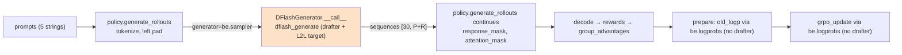

# 08 — DFlash: speculative rollouts on top of the L2L target

**What you will be able to explain after this file**
- Why a drafter exists in this repository, how it is loaded, where its weights live, and why the optimizer never sees it.
- One DFlash rollout of this task, token by token: prefill, block construction, drafting, verification, acceptance, KV-cache cropping.
- Why the emitted tokens follow the current LoRA policy's distribution, and which caveats sit under the word "exact".
- The exact line where DFlash ends and ordinary GRPO begins.
- Why DFlash can save at most about one weight sweep per GRPO step for four-token sentiment answers, and why its prefill is the predicted memory peak.

Prerequisites: [01](01-batches-groups-microbatches.md) (B, G, N = 30), [04](04-l2l-weight-streaming.md) (one "sweep" = 36 layer copies, 7.267 GB), [03](03-qwen3-forward.md) (KV cache, RoPE positions).

---

## 1. Intuition: what problem is DFlash solving here?

In plain autoregressive decoding every new token costs one full forward of the target. Under L2L a forward is not
just compute: it streams all 36 decoder slabs (7,267,018,752 B) from pinned CPU memory over PCIe **[code]**
(`weight_store.py:298-319`, [04](04-l2l-weight-streaming.md)). Generating R tokens therefore costs R weight sweeps.

Speculative decoding trades target passes for a cheap guesser: a small **drafter** proposes several future tokens, and
the target checks all of them in **one** pass. Each accepted guess saves one target pass, i.e. one sweep of 7.27 GB.

DFlash (z-lab, arXiv 2602.06036, cited in `qwen_grpo/execution/dflash.py:3`) is a specific drafter design:

| ordinary speculative decoding | DFlash as implemented here |
|---|---|
| drafter is a separate small LM with its own embedding/head | drafter has **no** embedding or head of its own: it reuses the target's embedding and tied LM head (`dflash.py:10-11, 118-123`) |
| drafter conditions on token ids | drafter conditions on **target hidden features** from layers 1, 9, 17, 25, 33 (`dflash.py:5-6`) |
| drafter decodes its guesses one by one | drafter fills a whole block of mask tokens in one non-causal pass ("block diffusion", `dflash.py:7-9`) |

**Why it is in this repo:** Ticket 12 / H10 (`research/l2l/hypotheses.yaml` H10): "DFlash reduces target-model
execution overhead while preserving the current LoRA policy's output distribution". It is enabled in the final run
(`configs/experiments/qwen3_4b_final.yaml:55-57`). Whether it actually helps is **[unverified]**: H10 is `untested`.

---

## 2. Loading: where the drafter comes from and where it lives

### 2.1 The loading path **[code]**

`trainer._train` → `make_backend(cfg, model, device)` (`trainer.py:523`) → because `cfg.dflash.enabled`
(`backend.py:99-110`):

1. `DFlashDrafter.from_pretrained(cfg.dflash.draft_model, dtype=<frozen base dtype = bf16>, device=device)`
   (`backend.py:101-102`).
2. `from_pretrained` (`dflash.py:100-116`):
   - `snapshot_download(..., allow_patterns=["config.json", "model.safetensors"])` — only the config and the weights;
     **no remote Python code is downloaded or executed** (the drafter class is re-implemented in `dflash.py:40-144`).
   - builds a `Qwen3Config` from the JSON, attaches `dflash_config` (`mask_token_id` 151669, `target_layer_ids`
     [1, 9, 17, 25, 33]) and `block_size` 16 (values read from the cached `config.json`).
   - `load_state_dict(strict=False)` then **re-checks strictly by hand**: any missing key (except the computed
     `rotary_emb` buffers) or unexpected key raises (`dflash.py:112-115`).
   - `.to(device=cuda, dtype=bf16).eval().requires_grad_(False)` (`dflash.py:116`).
3. `make_backend` asserts the drafter is frozen and in eval mode (`backend.py:103-104`).
4. Only `be.sampler` is replaced: `be.sampler = DFlashGenerator(drafter, be.executor, kv)` (`backend.py:108`).
   `be.greedy` (evaluation) and `be.logprobs` (old log-probs, GRPO loss) are untouched.

`config.py` adds two guards: `DRAFTERS = {"z-lab/Qwen3-4B-DFlash-b16": "Qwen/Qwen3-4B"}` (`config.py:122`) — the
drafter must match `model.name` (`config.py:281-282`) — and DFlash with the resident backend is refused
(`config.py:319`, `backend.py:112-113`).

### 2.2 Where its tensors live

| Tensor | Shape (Qwen3-4B drafter) | Dtype | Device | Lifetime |
|---|---|---|---|---|
| 5 `DraftLayer`s (q,k,v,o, MLP, 4 norms each) | per layer ≈ 100.9 M params | bf16 | GPU, permanent | whole run |
| `fc` | [2560, 5·2560 = 12800] | bf16 | GPU, permanent | whole run |
| `hidden_norm`, `norm` | [2560] | bf16 | GPU | whole run |
| total | 537,455,360 params ≈ **1.075 GB** (budget file: 1.001 GiB) | | | |

The drafter is **resident**, not streamed: it is ~1/7 of the target and runs every round, so streaming it would add a
1 GB copy per round. It is **not a submodule of `model`**, therefore:
- `model.named_parameters()` never yields it → not in `params`, not in AdamW (`trainer.py:527, 546`);
- `model.save_pretrained` never writes it → not in checkpoints;
- the frozen-weight digest check (`trainer.py:545, 778`) does not cover it (it is frozen by `requires_grad_(False)`
  and never receives a gradient because rollouts run under `@torch.no_grad()`, `dflash.py:152, 178`).

Evaluation never loads it: `make_evaluation_backend` replaces `cfg.dflash` with the disabled default
(`backend.py:124-130`); during training, evaluation uses `backend.greedy` (`trainer.py:549`), the plain generator.

---

## 3. The algorithm, on this task's numbers

Fixed settings: N = 30 rows (5 prompts × G = 6, `repeat_interleave`, `dflash.py:193-194`), `max_new_tokens` 4, block
size 16, padded prompt width P (73 for the first real batch; see [01](01-batches-groups-microbatches.md)).

### 3.1 Prefill (target pass #1) **[code]** `dflash.py:198-209`

```
cache = KVCache(36 layers, rows 30, kv_heads 8, capacity P + 4 + 16, head_dim 128, bf16, kv_device=cuda)
pos   = _positions(mask)                         # cumsum(mask)-1, padding positions set to 1
logits, feats = _target_step(model, ids[30,P], mask, pos, arange(P), cache, executor, [1,9,17,25,33])
nxt   = multinomial(softmax(logits[:, -1:]))     # first response token = the target's own draw
```

`_target_step` (`dflash.py:152-168`) is the same layer loop as the plain generator's `_step`
(`generator.py:80-92`), streaming every layer through the L2L executor, with two differences:
1. after layers 1, 9, 17, 25 and 33 it keeps the hidden state: 5 tensors [30, P, 2560] bf16, concatenated to
   `feats` [30, P, 12800] (`dflash.py:165-168`);
2. it applies the LM head to **every** column: `lm_head(decoder.norm(hidden)).float()` (`dflash.py:167`), giving
   bf16 [30, P, 151936] and then an fp32 copy. Only `logits[:, -1:]` is used (`dflash.py:204`). The plain generator
   keeps only the last column (`generator.py:92`). See §6 for the memory consequence.

The KV cache's capacity has 16 spare columns beyond `P + max_new` because a verify block may write up to `bs`
columns before being cropped (`dflash.py:198-199`).

### 3.2 One round (target pass #2, #3, ...) `dflash.py:211-242`

State after prefill: `ids` [30, P+1]; the cache holds P columns (the last token is **not** yet in the cache — it is
the next block's first input, exactly as in plain decoding).

```
L = P + 1                                        # committed length
q = min(16, P + 4 - L + 1) = 4                   # block may not run past max_new_tokens (dflash.py:213)
block = [ids[:, -1], MASK, MASK, MASK]           # [30, 4], MASK = 151669        (dflash.py:214-215)
draft = drafter.propose(...)                     # [30, 3] = argmax(target_lm_head(drafter_hidden[:, 1:]))
block[:, 1:] = draft
logits, feats = _target_step(model, block, ..., cache_position = L-1 .. L+2)   # ONE target sweep, q=4 columns
y     = multinomial(softmax(logits))             # [30, 4]: the target's own draw at every block position
match = cumprod(block[:, 1:] == y[:, :-1]).sum(1)  # accepted drafts per row, 0..3       (dflash.py:225)
m     = min(match over unfinished rows)          # all rows advance together          (dflash.py:226-227)
emitted = [block[:, 1:1+m], y[:, m]]             # m accepted drafts + one target draw (dflash.py:228)
```

Then each emitted column is appended with the plain generator's EOS/pad rule, never past `max_new_tokens`
(`dflash.py:229-235`); the target cache is **cropped** to `committed − 1` (`crop` only lowers `lengths`,
`dflash.py:147-149, 237`), throwing away the KV of rejected drafts; the drafter's next context is the target features
of the block inputs that are now committed and cached (`dflash.py:241-242`).

### 3.3 Worked example (this task)

Prompt "Classify the sentiment ... ONE WORD ONLY ... Sentence: <text>"; tokenization (Qwen3 tokenizer, offline):
`POSITIVE` = [`POS`, `ITIVE`], `NEGATIVE` = [`NEG`, `ATIVE`], `Positive` = 1 token, end of turn `<|im_end|>` = 151645.

| target pass | what happens | committed response columns |
|---|---|---|
| 1 (prefill, q = P) | 30 rows draw their first token: say 18 × `POS`, 11 × `NEG`, 1 × `Positive` | 1 |
| 2 (verify, q = 4) | block row k = [`POS`, M, M, M]; drafter proposes [`ITIVE`, `<|im_end|>`, x]. Target draws y = [`ITIVE`, `<|im_end|>`, …]. If **every** live row matches its first two drafts, m = 2 → emit `ITIVE`, `<|im_end|>` (+ y₂ would be the 4th column but rows are finished) | 3, all rows hit EOS → loop ends |

DFlash: **2 target sweeps**. Plain decoding of the same answers: 3 sweeps (`POS`, `ITIVE`, `<|im_end|>`; the plain
loop stops when every row has emitted an EOS, `generator.py:142-144`).

The failure case: the "Positive" row's block is [`Positive`, M, M, M]; if the drafter proposes `<|im_end|>` it
matches; if it proposes anything else for any one row, that row has match 0, so **m = 0 for all 30 rows**
(`dflash.py:227`): every row emits one token (y₀) and a third pass is needed. Worst case: 1 prefill + 3 verify passes
= 4 sweeps, the same as plain decoding with 4 columns, but each verify pass processes 4 columns plus the drafter.

All numbers in this table are **[predicted]**: acceptance on Qwen3-4B has never been measured (H10 untested).

---

## 4. Why the emitted tokens follow the target (current LoRA) policy

**Claim** (`dflash.py:14-22`): each row's sequence has the law of sampling from the target policy at temperature 1.

**Argument.** Fix a row. At block position j, the target computes the next-token distribution
p(· | prefix, d₁ … d_j) and draws y_j from it. The row emits d₁ … d_m (each equal to y_{j−1}, so each is the target's
own draw given exactly the emitted prefix) and then y_m, which is also a draw given the emitted prefix d₁…d_m. So
every emitted token is a draw from p(· | emitted prefix). Whether the row stops at m depends only on draws already
made (its own matches and other rows' independent draws), i.e. it is a stopping rule adapted to the past; discarded
later draws y_{m+1}, … are never used. The joint law of the emitted sequence is therefore ∏_t p(o_t | o_<t).
For an argmax (point-mass) drafter this coincides with standard speculative sampling's accept/resample law
(accept with probability p(draft), else resample from p restricted to ≠ draft) (`dflash.py:21-22`).

**The verifier is the policy being trained.** `_target_step` runs `model` — the PEFT model with the current LoRA
adapters on layers 34–35 — through the same executor as everything else (`dflash.py:161-164`). The drafter was
trained against the base Qwen3-4B, so as the LoRA policy drifts, acceptance may fall; correctness does not depend
on it (H10.dflash_drift measures acceptance at steps 0/20/40/60, `configs/studies/assignment.yaml`).

### Caveats under the word "exact"

1. **Exact in law, not bitwise.** DFlash consumes the CUDA RNG differently (one `multinomial` over [30·q, V] per
   round, `dflash.py:171-175`), so a DFlash run and a plain run with the same seed produce different rollouts.
   Runs are comparable statistically, not row by row.
2. **"The target distribution" is a floating-point object.** y_j is drawn from logits of a q-column block pass in
   bf16. The same position decoded one token at a time (plain generator), or teacher-forced over the whole sequence
   (`prepare` → `old_logp`), uses different matmul shapes and attention lengths, so the probabilities can differ in
   the last bits. The GRPO ratio is computed between two teacher-forced passes (`training.py:119-123`), not against
   the sampling pass, so this mismatch never shows up as a ratio ≠ 1; it is an unmeasured off-policy error of
   rounding size **[unverified]** at 4B.
3. **Batched acceptance couples rows only through the stopping time**, which preserves the law (argument above) but
   kills the speedup when any row disagrees (§5).
4. Tests are on tiny models: greedy DFlash equals plain streamed generation with random and oracle drafters
   (`tests/test_dflash.py:85`), and sampled DFlash matches the exact joint law of the first two tokens by chi-square
   at p < 10⁻³ (`tests/test_dflash.py:134`) **[test]**. Nothing on Qwen3-4B **[unverified]**.

---

## 5. Where DFlash ends and GRPO begins



The DFlash path is exactly the call `generator(model, input_ids, attention_mask, num_return_sequences=G, ...)` at
`policy.py:265-267`, which returns a `[30, P+R]` id tensor. From `policy.py:275` on (`response_ids`,
`response_mask`, the concatenated attention mask), and everything in `trainer._train` after line 686 —
`check_grouping`, `decode`, `group_rewards`, `prepare`, `RolloutStore.write`, `grpo_update`, evaluation — is
identical to a plain-L2L run. The only trace DFlash leaves in the training log is `rollout_evidence`
(`trainer.py:461-475`): generator class, drafter bytes, target passes and accepted drafts per pass, kept outside
the bitwise-compared training rows.

What DFlash does **not** change: the GRPO objective, the LoRA parameters, the optimizer, the old log-probs, the
evaluation decoding. It changes *how* rollout tokens are produced, not *what distribution* they come from (modulo
caveat 2).

---

## 6. Cost–benefit for 4-token answers **[predicted]**

### 6.1 Weight sweeps per GRPO step

| phase | sweeps (36 layer copies each, 7.267 GB) |
|---|---|
| rollout, plain | = generated columns R ≤ 4 (typically 3 for `POS ITIVE <|im_end|>`) |
| rollout, DFlash | 1 prefill + 1..3 verify (2 in the best case above) |
| `prepare` (old log-probs, 5 chunks of 6) | 5 |
| `grpo_update` forward (5 chunks) | 5 (backward recompute of layers 34–35 is a buffer hit, 0 copies; [05](05-cuda-prefetch-and-buffer-safety.md)) |
| **total** | plain ≈ 13, DFlash best ≈ 12 |

Best case DFlash saves one sweep of ~13: about **7% of PCIe bytes per step**. The saving is capped by
`max_new_tokens = 4`: with q = min(16, …) the first block has only 3 draft slots (`dflash.py:213`), and
the 10 training sweeps are untouched by DFlash.

### 6.2 What it costs

- **+1.075 GB permanently resident** drafter weights (§2.2).
- **The prefill LM head over all P positions** (`dflash.py:167`): [30, P, 151936] bf16 + fp32 `.float()` copy.
  At P = 73: 0.666 GB + 1.331 GB ≈ **2.0 GB**; at the observed max P = 93: **2.54 GB**. The budget prediction
  (P = 100) puts the run's GPU peak here: 5.329 GiB allocated, 6.362 GiB device with an assumed 0.5 GiB CUDA context
  (`results/budget/predictions/qwen3-4b-final-dflash_8gb.md`) **[predicted]**. The plain generator's equivalent
  tensor is [30, 151936] fp32 = 18.2 MB. See [09](09-memory-and-tensor-lifetimes.md).
- **Larger KV cache**: capacity P + 20 instead of P + 4 (411 MB vs 341 MB at P = 73).
- Drafter compute per round, feature tensors ([30, P, 12800] bf16 ≈ 56 MB at P = 73), and one host sync per round
  (`int(match[live].min())`, `dflash.py:227`).

### 6.3 Why the batch kills acceptance

m is a **minimum over 30 rows** (`dflash.py:227`). At temperature 1, each row's y_j is random; one row drawing
something other than the draft at position 1 forces m = 0 for everyone. `docs/l2l/12_dflash.md` records that a
6,000-row test batch accepted nothing and the sampling test needed single rows. Per-row ragged acceptance would need
per-row cache lengths, which are not implemented. For this task the label continuation (`POS`→`ITIVE`→`<|im_end|>`)
is nearly deterministic, so m = 2 is plausible — but this is a guess, not a measurement.

**Honest summary for an interview:** DFlash is implemented correctly in law and is cleanly isolated to rollout
generation, but for 4-token answers the theoretical upside is ~1 of ~13 weight sweeps, while it adds the run's
largest predicted transient. Its inclusion is justified by the assignment's ticket, not by a measured win.

---

## 7. Failure modes and what catches them

| failure | consequence | detection |
|---|---|---|
| drafter trained for another target | garbage drafts (still exact in law, just slow) | `DRAFTERS` check `config.py:281-282` |
| drafter weights partly missing | wrong drafts | hand strict-key check `dflash.py:112-115` |
| drafter accidentally trainable / in optimizer | policy would include drafter | `backend.py:103-104`; not a submodule of `model` |
| KV cache not cropped after rejection | attention would see rejected drafts → wrong distribution | `crop` `dflash.py:237`; oracle-drafter tests with rejections `tests/test_dflash.py:85` [test] |
| wrong drafter-context bookkeeping | worse drafts only (verification still exact) | same tests |
| emitting past `max_new_tokens` | longer responses than plain | `q` bound `dflash.py:213` and emit guard `dflash.py:230` |
| prefill logits OOM at large P | run stops (guard) | memory guard/telemetry ([09](09-memory-and-tensor-lifetimes.md)) |

## Open questions / unverified

- **Acceptance and passes per token on Qwen3-4B**, at temperature 1, batch 30: `H10.dflash_bench` (`scripts/dflash_bench.py`) on a GPU host.
- **Whether DFlash reduces GRPO step wall time** at all for 4-token rollouts: same bench, "one full GRPO step with each rollout generator".
- **Acceptance drift as the LoRA policy moves away from the base**: `H10.dflash_drift` on checkpoints step0/20/40/60.
- **Measured peak during DFlash prefill** vs the 5.33 GiB prediction: `H10.smoke_dflash` with per-process nvidia-smi (assignment-grade evidence).
- **Size of the rounding gap** between block-pass sampling logits and teacher-forced `old_logp` at bf16: log both for one batch and compare (no script exists).
- Whether applying the LM head only to the last prefill column (as the plain generator does) would remove the predicted peak: a code change, not done here.
