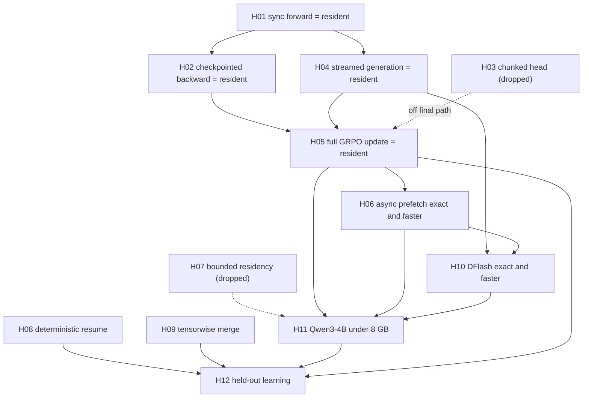

# 11: The research program, H01 to H12

**What you will be able to explain after this file**
- For each hypothesis H01–H12: the engineering problem behind it, what was built, how it is tested, and what the evidence does and does not show.
- Why most correctness thresholds are **0** (bitwise equality against a resident reference), and what that buys and costs.
- Which hypotheses are supported, untested, dropped from the default protocol, or have stale evidence.
- Which ideas come from which paper, which are custom engineering, and which paper ideas were **not** implemented.

Evidence labels: **[code]**, **[test]**, **[measured]**, **[predicted]**, **[unverified]** (see [00-reading-map.md](00-reading-map.md)).

---

## 0. How to read a hypothesis in this repository

Three files define every hypothesis, and they deliberately do not overlap:

| File | Holds | Who may change it |
|---|---|---|
| `research/l2l/hypotheses.yaml` | statement, criterion (written **before** the acceptance run), recorded status, cited evidence | by hand only, citing a saved result |
| `research/l2l/tolerances.yaml` | numerical thresholds per case → backend → dtype → quantity, each with a `why` | never widened to rescue a failing run (`protocol.md` "Rules") |
| `research/l2l/protocol.md` | pairing with the resident reference, statuses, fault injection, memory-evidence grades | — |

`configs/studies/assignment.yaml` only says *which existing command* tests a hypothesis and where it can run. `scripts/experiment.py` dispatches; it "never edits research/l2l/hypotheses.yaml" (its docstring).

Three statuses you must not confuse (protocol.md "Statuses"):
- `execution_status` — did the experiment run validly (PASS / FAIL / BLOCKED);
- `hypothesis_result` — SUPPORTED / NOT_SUPPORTED / INCONCLUSIVE / NOT_EVALUATED;
- `status` — the acceptance status (PASS iff execution PASS and every comparison within threshold).

A **fault-injection control** must come out `status FAIL, execution PASS`: the corruption was injected, the run completed validly, and the comparison caught it. That is the judge `lab_fault` in the study file.

### Why the thresholds are mostly zero

`tolerances.yaml` sets `atol: 0, rtol: 0` for forward, gradient, update and most generation quantities. The argument (Ticket 00, `fixture_equivalence.why`):
- The L2L path calls **the same HF/PEFT modules** with **the same weight bytes** (WeightStore copies bytes, never casts) at **256-byte-aligned addresses** (so kernel selection by alignment cannot differ), with the same thread count.
- Same inputs + same kernels + same reduction order ⇒ identical floating-point results.
- Any difference is therefore a defect, not rounding.

Consequence: the test is extremely strong *where it applies* (it catches a single wrong weight, a one-step-stale position id, a detached boundary), but it only applies where both sides run the same kernels. Where kernel shapes change (chunked output head, KV-cached vs full-prefix decoding, DFlash block verification) the repo uses non-zero, derived tolerances or distribution tests instead.

Weakness to state openly: bitwise equality on **tiny random models** says the plumbing is right; it does not by itself say anything about bf16 numerics at 4B scale, kernel selection on a different GPU, or long-run training dynamics.

---

## H01: Synchronous L2L forward equals resident

1. **Problem.** Qwen3-4B's bf16 weights (≈8.05 GB, 36 layers × 192.5 MiB + 741.9 MiB embedding) cannot sit on an 8 GB card with context, activations and KV cache. The forward pass must run with only one or two layers' weights on the GPU.
2. **Statement.** "Synchronous L2L produces the same logits as resident Qwen3 execution."
3. **Why reasonable.** A decoder layer is a pure function of (input hidden, weights, masks, RoPE). If the weights it reads are byte-identical and the kernels are the same, the output is identical, wherever the bytes came from.
4. **Alternatives.**
   - Keep some layers resident (`execution.resident_layers > 0`) — accepted by the schema, **refused** by `config.unimplemented` (`qwen_grpo/config.py:316`).
   - Re-implement the layer arithmetic in custom kernels (MegaTrain's "stateless templates") — rejected; the repo re-points the HF/PEFT module's own `Parameter.data` instead (`layer_stream.py:76-100`).
   - Quantize (QLoRA/NF4) so the model fits — the assignment says "No quantization is required"; Soup ELS v3 measured NF4 dequantisation as its largest streaming-specific cost.
5. **Implemented [code].** `qwen3_forward.explicit_forward` (the explicit layer loop), `layer_stream.StreamingLayerExecutor` (copy slab → re-point params into the buffer → run the unchanged layer → re-point back), `weight_store.WeightStore` (per-layer slabs). Details: [04-l2l-weight-streaming.md](04-l2l-weight-streaming.md).
6. **Justification.** Determinism argument above; plus the explicit forward must equal HF's `Qwen3ForCausalLM.forward` bitwise (reference integrity).
7. **Verification.** Lab case `forward_equivalence`. Grid: two tiny shapes (0.6B-like GQA 2:1, 4B-like GQA 4:1) × eager/sdpa × fp32/bf16 × LoRA placements × 1 or 2 buffers × padded/unpadded × logit-column selections. Threshold 0. Execution requirements: every weight a kernel reads lies inside the buffer pool; allocated device memory before each layer copy is identical for all layers after the first. Fault control: `wrong_layer` (must FAIL).
8. **Failure modes.** Wrong slab bound to a layer; stale buffer; a param left pointing at the GPU view after the call (would silently pin GPU memory and break the store invariant I1); misaligned views selecting different kernels.
9. **Evidence limits.** Tiny random models; `use_cache=False`; forward only. Real-model evidence comes indirectly via H05's real 0.6B steps.
10. **Status.** hypotheses.yaml **SUPPORTED** (`t03_forward_equivalence`, 2690 comparisons). final_report R1 **PASS**, but "Evidence freshness" lists engine files changed since (`layer_stream.py`, `weight_store.py`, `qwen3_forward.py`, …). The async variant `H01.lab_async_cuda` (`t08_forward_equivalence_async`) has **no result**.

## H02: Checkpointed L2L backward equals resident autograd

1. **Problem.** Autograd normally saves, for backward, references to the weight tensors used in forward. Under L2L those tensors are *views of a buffer that the next layer overwrites*. Backward would silently read the wrong weights.
2. **Statement.** "Checkpointed L2L backward produces the same LoRA gradients as resident autograd."
3. **Why reasonable.** If each layer is wrapped in a custom autograd node that saves only its *input* hidden state and, in backward, re-streams the same weight bytes and recomputes the layer with the same kernels, the recomputed graph is identical to the resident one, so the gradients are too.
4. **Alternatives.** `torch.utils.checkpoint` (would still capture views of buffers inside the recomputation unless the binding is controlled; no hook to re-stream weights); keep all activations (memory grows with depth); offload activations to CPU.
5. **Implemented [code].** `execution/backward.py`: `_CheckpointedLayer` (forward with grad off, `save_for_backward(hidden, *lora)`, exact int64 checksum of the output; backward re-binds the weights via `executor.bound`, recomputes with grad on, `autograd.grad` w.r.t. hidden and the LoRA leaves, checks the checksum). See [06-checkpointed-backward.md](06-checkpointed-backward.md).
6. **Justification.** Chain rule per layer: given g_{i+1} = ∂L/∂h_{i+1}, the node returns (∂L/∂h_i, ∂L/∂θ_i^{LoRA}) = VJP of f_i at (h_i, θ_i) applied to g_{i+1}. Recomputing f_i at the same (h_i, W_i, θ_i) gives the same VJP.
7. **Verification.** Lab case `gradient_equivalence`: GRPO loss of the fixture rollouts in two micro-batches; every LoRA `.grad` after micro-batch 1 and after accumulation, every dL/d(layer output), loss and logits; threshold 0; LoRA placements final / last2 / middle / first+last / distributed. Fault controls: `detach_boundary` and (async) `unsafe_reuse`.
8. **Failure modes.** A detached boundary (gradient stops flowing, LoRA below gets zero grad); state changed between forward and backward (adapter disabled) — caught by the checksum; a buffer overwritten while a layer reads it (H02 fault below).
9. **Evidence limits.** Tiny models on CPU and on the historical RTX 3050 Ti; one real Qwen3-0.6B step bitwise (`real_step_*`). Async variant has no `t08_*` result on a GPU.
10. **Status.** hypotheses.yaml **SUPPORTED**; final_report R2 **PASS** (`t04_gradient_equivalence_cuda`), stale per freshness table. `H02.lab_async_cuda` not run.

### The H02 unsafe-reuse correction (2026-11-18)

This is the most instructive episode in the program; [05-cuda-prefetch-and-buffer-safety.md](05-cuda-prefetch-and-buffer-safety.md) has the timeline. Summary from `research/l2l/corrections/h02_unsafe_reuse_20261118/README.md`:
- **Before the fix (`before_fix/`, commit e8440e4, CPU).** Fault `unsafe_reuse=2` on 80 configurations:
  - 48 were refused by backward's recomputation checksum, which the lab recorded as an *error*, so the fault judge said "not detected";
  - **32 ran to completion with wrong logits, losses and gradients and nothing raised.** Corrupted layer 2 was *below the lowest LoRA layer* (`_graph_floor`), so it is never recomputed and the checksum has nothing to compare.
- **Root cause.** R1/R3 (do not overwrite a slot in use / in the prefetch window) were enforced only by the slot-selection policy `_victim`, not at the copy.
- **Fix [code].** `prefetch._claim` validates every copy against slot ownership before it is enqueued and raises `BufferReuseError` (`qwen_grpo/execution/prefetch.py:89-106`, called from `_copy` at :110 and `_prefetch` at :161). Harness changes classify that refusal as a detection.
- **After the fix [measured, CPU only].** 80/80 refused for `unsafe_reuse` 0, 1, 2; for `unsafe_reuse=3`, 32 configurations never fire the fault ("no power") and are reported as such. H05 update equivalence still passes (6528 comparisons, sync and async).
- **Not done.** The GPU rerun. In experiment mode `H02.fault_unsafe_reuse` is still **WAIVED** (`scripts/assignment.py:148`), and the recorded FAILs are kept.

Lesson for the interview: a numerical check that only covers *recomputed* layers cannot protect layers that are computed once. Safety must be structural (ownership), not observational.

## H03: Memory-efficient output head

1. **Problem.** Vocabulary V = 151,936. Full logits for a training micro-batch are [n, T, V]; for the DFlash prefill, [30, P, V] fp32 ≈ 1.3 GB at P = 73 (see [09-memory-and-tensor-lifetimes.md](09-memory-and-tensor-lifetimes.md)).
2. **Statement.** "Memory-efficient output-head computation preserves GRPO log-probabilities and gradients."
3. **Why reasonable.** log softmax(z)_t = z_t − logsumexp(z); logsumexp can be computed online over vocabulary chunks (running max m and rescaled sum s), and the backward only needs softmax, recomputable chunk by chunk.
4. **Alternatives.** (a) `logits_to_keep = R+1` — only score response positions: **this is what training actually uses** (`policy.compute_logprobs`, `output_head.streamed_logprobs` with `vocab_chunk_size=None`), so training logits are [6, R+1, V] ≈ 18 MB fp32, small enough that chunking is unnecessary. (b) Chunked head `_SelectedLogprobs` (`output_head.py`).
5. **Implemented.** The chunked head exists and is tested, but `execution.vocab_chunk_size` is **refused for training** by `config.unimplemented` (`config.py:317`, "H03 unresolved").
6. **Justification.** Online logsumexp is exact in real arithmetic; in floating point the summation order changes, so tolerances are non-zero (logp 1e-4, loss 4e-4, gradients 1e-4 fp32 / 2⁻⁶ bf16 of the max).
7. **Verification.** `logprob_equivalence`, V ∈ {64, 1000, 151936}, R ∈ {1, 4, 16}, two chunk sizes (one with a remainder), 4 AdamW iterations with clipping. Fault control `raw_logit`.
8. **Failure modes.** Unnormalized logit returned; a dropped remainder chunk; summation-order drift breaking `INIT_TOL`.
9. **Limits.** CPU, tiny models, no GPU evidence.
10. **Status.** **SUPPORTED** in hypotheses.yaml (v2, 20,304 comparisons); R3 PASS (non-essential). **Dropped from the default protocol** by commit e8440e4 (`scripts/assignment.py:94-99`, `assignment_report.py:174` `DROPPED`): it is off the final path. Note the irony: the only place where a chunked head would matter — DFlash's prefill LM head over all prompt positions (`dflash.py:167`) — does not use it.

## H04: Streamed generation equals resident generation

1. **Problem.** Rollouts must be generated without `model.generate()` (which assumes resident weights) and with an explicit KV cache, through the same layer executor.
2. **Statement.** "Streamed generation follows the same target-policy distribution as resident generation."
3. **Why reasonable.** The loop in `generator.generate` reproduces HF `_sample` for the settings used: `repeat_interleave` expansion, `cumsum(mask)−1` positions with padding set to 1, `create_causal_mask`, fp32 last-column logits, `multinomial(softmax)` at T = 1.
4. **Alternatives.** HF `generate` with an offloading hook (no control over buffers, prefetch, or the DFlash features); KV cache on CPU (`execution.kv_cache: cpu` — supported by `KVCache`, but the final config uses `gpu`).
5. **Implemented [code].** `execution/generator.py` (`KVCache`, `_step`, `generate`, `StreamedGenerator`). See [08-dflash-integration.md](08-dflash-integration.md) and [01-batches-groups-microbatches.md](01-batches-groups-microbatches.md).
6. **Justification.** Same mask, positions and kernels ⇒ same next-token logits ⇒ same distribution (and same samples under the same RNG stream).
7. **Verification.** `generation_equivalence`: greedy sequences and per-step logits equal to `generate()` (0); probabilities along HF-sampled trajectories (teacher-forced) equal (0); cached vs full-prefix forward within a derived rounding bound (`prefix_logits` rtol 1e-5 fp32, 2⁻⁶ bf16); EOS-boosted model; real-vocabulary model with Qwen3 chat prompts. Faults: `stale_position`, `no_padding_mask`.
8. **Failure modes.** Off-by-one `cache_position`; padding attended; a finished row continuing to emit tokens.
9. **Limits.** Tiny models; real 0.6B rollouts equal HF's in `real_step_*` (CUDA laptop). No 4B evidence; async variant untested.
10. **Status.** **SUPPORTED**; R4 PASS (stale per freshness).

## H05: A complete streamed GRPO update equals a resident update

1. **Problem.** Individually correct forward, backward and generation do not guarantee the composed update is correct (micro-batch scaling, old log-prob reuse, optimizer state, Parameter identity).
2. **Statement.** "A complete streamed GRPO + LoRA optimizer update is numerically equivalent to a resident update."
3. **Why reasonable.** The GRPO math (`training.grpo_update`, `grpo.grpo_loss`) is shared; the backend only supplies `logprobs`. If log-probs and gradients are bitwise equal, AdamW is too.
4. **Alternatives.** TRL `GRPOTrainer` (would need its generation and forward to run through the L2L executor; no hook for per-layer weight placement).
5. **Implemented [code].** `execution/backend.py` (`ResidentBackend` / `L2LBackend`), `training.prepare` / `grpo_update`.
6. **Justification.** Composition of H01, H02, (H04 for rollouts).
7. **Verification.** `update_equivalence`: 3 iterations of `grpo_update`, micro-batch size {all, 1, 2, 4}, fresh/warm AdamW state; logp, loss, clip stats, grads, updates, AdamW state, threshold 0; must clip after iteration 0 (power). Fault `advantage`. Supplementary real-model evidence:
   - `real_step_20261117T063325Z`, `real_step_20261117T063548Z` — two Qwen3-0.6B bf16 GRPO updates, L2L vs resident on an RTX 3050 Ti Laptop GPU (WSL2), `max_abs 0` for old_logp, logp, grads **[measured]**. Note the recorded loss: `1.19e-08` — the GRPO loss at ratio 1 is zero by construction (group advantages sum to 0), see [07-grpo-mathematics.md](07-grpo-mathematics.md).
   - `compare_qwen_resident_vs_qwen_l2l` — 100-step Qwen3-0.6B training, resident vs **l2l_sync**, training rows and evaluations identical **[measured]**.
8. **Failure modes.** Wrong micro-batch scaling; recomputing old_logp after the update; optimizer holding stale Parameter objects after the store re-points `.data`.
9. **Limits.** Real-model evidence is **sync** L2L only, 0.6B, one laptop GPU; `micro_batch_size: null` in the 0.6B run, whereas the final 4B config uses 6. The new 10-step real-model entry `H05.real_0.6b_bf16` (resident vs sync vs async, `qwen3_0.6b_*_short.yaml`) has not run.
10. **Status.** **SUPPORTED**; R5 PASS (`t07_update_equivalence_cuda_v2`, stale). `t07_update_equivalence_cuda` (v1) is execution FAIL by lab design, kept.

## H06: Asynchronous prefetching is faster and exact

1. **Problem.** Synchronous streaming serializes copy and compute: per layer, ~192.5 MiB H2D (≈30 ms at 6.58 GB/s, the pinned rate measured on the laptop, `t02_pinned_transfer`) then compute.
2. **Statement.** "Double-buffered asynchronous prefetching reduces execution time without changing numerical results."
3. **Why reasonable.** If copy(i+1) runs on a separate stream while compute(i) runs, a step costs ≈ Σ max(copy, compute) instead of Σ (copy + compute).
4. **Alternatives.** Deeper prefetch (`prefetch_depth > 1`, more buffers); MegaTrain's CPU-worker staging into two pinned buffers from a pageable store; L2L's layer-major micro-batch loop (amortizes each copy over all micro-batches) — **not implemented**.
5. **Implemented [code].** `execution/prefetch.py` (`Slot`, R1–R4 with CUDA events, `_claim`, timeline events measuring real overlap). See [05-cuda-prefetch-and-buffer-safety.md](05-cuda-prefetch-and-buffer-safety.md).
6. **Justification.** Overlap is only real if (a) the source is page-locked (otherwise `non_blocking` copies are synchronous), (b) the GPU has a free copy engine, (c) compute(i) is long enough to hide copy(i+1). For decode steps with 30 rows × 1 token, compute is tiny and the step is transfer-bound regardless. Soup ELS v3 warns the opposite can also be true (its streamed step was compute-bound).
7. **Verification.** Correctness precondition: H01/H02/H04/H05 under `l2l_async` with `verify=True` (byte checksum per use). Performance: `prefetch_timing` on real Qwen3-0.6B, sides interleaved after warmup, SUPPORTED iff the bootstrap 95% CI of the async/sync median ratio lies entirely below 1. Overlap reported only from CUDA event timestamps.
8. **Failure modes.** Buffer overwritten in use (H02 episode); copy issued from pageable memory (no overlap, silently); host-side `.item()` syncs serializing the pipeline (e.g. `dflash.py:227`, `int(match[live].min())`).
9. **Limits.** Async equivalence only on CPU tiny models **[test]** (`tests/test_prefetch.py`; on CPU there are no streams, so this tests ownership logic, not timing hazards).
10. **Status.** **untested**; R6 and R7 NOT TESTED.

## H07: Bounded GPU weight residency

1. **Problem.** Memory must not grow with depth (the "constant memory" claim of L2L).
2. **Statement.** "Bounded layer residency reduces GPU weight-memory dependence on total model depth" (Ticket 11 variant: "GPU weight residency remains bounded as model depth increases").
3. **Why reasonable.** Only `weight_buffers` buffers of `max_slab_bytes` are ever allocated for decoder weights.
4. **Alternatives.** Resident layers trade memory for transfer (budget table "Layer residency": 1 resident layer PASSes, 6 FAIL **[predicted]**).
5. **Implemented [code].** `weight_store.gpu_buffers`, `WeightStore` I6 (building allocates nothing on the GPU).
6. **Justification.** Activation checkpoints still grow with depth in general, but here only layers ≥ 34 save a boundary (layers 0–33 build no node), so depth growth is irrelevant for this LoRA placement.
7. **Verification.** `store_depth` (copy-only) and `depth_residency` (execution).
8. **Failure modes.** A hidden GPU copy of the model; the caching allocator holding freed blocks.
9. **Limits.** `t02_store_depth` **[measured]**: streamed peak 3,148,800 B at depths 2–32, resident 3.2 → 50.5 MB; but copy-only, allocator statistics only (diagnostic grade).
10. **Status.** **SUPPORTED** for the Ticket 02 statement only; the Ticket 11 statement untested. R8 NOT TESTED. **Dropped from the default protocol** in e8440e4.

## H08: Deterministic crash-consistent resume

1. **Problem.** A long run on rented hardware will be interrupted. Resuming must reproduce the same committed trajectory: no duplicated or skipped prompts, no update applied twice.
2. **Statement.** "An interrupted and resumed run preserves the same committed training sequence as an uninterrupted run."
3. **Why reasonable.** If the sampler state, RNG states, optimizer state and adapter are saved atomically together at a commit point, and anything after it is discarded and regenerated, the replay is deterministic (given deterministic kernels).
4. **Alternatives.** Replay the sampler from the start (the non-streaming path does this: `trainer.py:664-666`); HF Trainer checkpointing (does not cover rollout records or sampler epochs).
5. **Implemented [code].** `streaming/dataset.py` (`PromptStream`), `streaming/rollouts.py` (`RolloutStore`), `streaming/resume.py` (`publish` with COMMIT.json, `validate`, `prepare`), `checkpointing.py` (RNG). See [12-streaming-and-resume.md](12-streaming-and-resume.md).
6. **Justification.** Commit semantics: an update is committed iff a published checkpoint contains it.
7. **Verification.** `scripts/resume_experiment.py`: run A uninterrupted; runs B crashing at six points (`prompt_read`, `rollouts_generated`, `update`, `files_written`, `committed_before_rename`, `after_checkpoint`); committed rows, records, checkpoints equal **exactly**.
8. **Failure modes.** Torn checkpoint; orphan rollout records mixed in; RNG restored at the wrong moment (`set_rng_state` is deliberately the last thing before the loop, `trainer.py:667-668`).
9. **Limits.** `t09_resume_tiny_cpu` **[measured]**: tiny random Qwen3 on CPU, 6 steps. With `num_iterations: 1` the "pending group" restore path is never exercised in the final config.
10. **Status.** **SUPPORTED**; R9 PASS (tiny only). `H08.resume_qwen3_0.6b` not run.

## H09: Tensor-by-tensor merge

1. **Problem.** The merged model must be produced without the full model on the GPU, and must match the adapter-attached policy.
2. **Statement.** "Tensor-by-tensor merging preserves the adapter-attached model's behaviour."
3. **Why reasonable.** W' = round(fp32(W0) + (α/r)·fp32(B)·fp32(A)) per tensor; other tensors copied byte for byte.
4. **Alternatives.** PEFT `merge_and_unload` (rounds the delta to bf16 and then adds in bf16: two roundings; needs the model built).
5. **Implemented [code].** `export/merge.py` `stream_merge` (CPU only, lazy safetensors reads, bounded shards).
6. **Justification.** One rounding of the exact fp32 sum; bf16 merge error ≤ half an ulp of each element.
7. **Verification.** `merge_equivalence`: half-ulp residual; merged vs adapter-attached logits within dtype bound; greedy tokens equal except at near-ties; **power check**: the adapter's own effect ≥ 100× (fp32) / 10× (bf16) the merge discrepancy.
8. **Failure modes.** Dropped α/r scale; wrong module; a bf16 delta smaller than half an ulp of W0 rounds away entirely (the adapter "disappears" in the merged model).
9. **Limits.** `t10_merge_equivalence_tiny` PASS **[measured, CPU]**; the real 0.6B variant has not run.
10. **Status.** **untested** (criterion needs every variant); R10 NOT TESTED.

## H10: DFlash speculative rollouts

1. **Problem.** Each target forward streams 7.27 GB of weights; plain decoding of R tokens costs R weight sweeps. Verifying a block of k draft tokens in one sweep could cut sweeps.
2. **Statement.** "DFlash reduces target-model execution overhead while preserving the current LoRA policy's output distribution."
3. **Why reasonable.** Speculative decoding with an exact accept rule preserves the target law; the drafter (≈1.07 GB) is resident, so it costs no PCIe.
4. **Alternatives.** Plain streamed decoding (`StreamedGenerator`); a classic small draft LM (needs no target features, but none trained for this target was named); per-row ragged acceptance (not implemented).
5. **Implemented [code].** `execution/dflash.py`. See [08-dflash-integration.md](08-dflash-integration.md).
6. **Justification.** Every emitted token is the target's own draw given the emitted prefix (`dflash.py:14-22`).
7. **Verification.** CPU tests (`tests/test_dflash.py`): greedy equality with random and oracle drafters, chi-square on the joint law of the first two tokens (p < 1e-3). Real model: `scripts/dflash_bench.py` (greedy equality at LoRA B scales 0/0.01/0.03; passes per token; timing); `H10.dflash_drift` on the final run's step0/20/40/60 checkpoints.
8. **Failure modes.** The drafter replacing the policy (rollouts off-policy); wrong KV crop; min-over-rows acceptance collapsing to 0.
9. **Limits.** Nothing on the real model. Predicted: with ≤ 4 new tokens, at most one or two sweeps saved per rollout out of ≈ 13–14 per GRPO step **[predicted]**, while the prefill LM head over all prompt positions is the predicted rollout memory peak.
10. **Status.** **untested**; R11, R12 NOT TESTED.

## H11: Qwen3-4B within the 8 GB budget

1. **Problem.** The assignment's hard constraint: "8 GB of GPU memory as shown by nvidia-smi (CUDA context included)".
2. **Statement.** "The complete Qwen3-4B system respects the 8 GB GPU-memory budget."
3. **Why reasonable.** Budget prediction: rollout peak ≈ 6.36 GiB device incl. 0.5 GiB assumed context (DFlash config), training ≈ 2.98 GiB **[predicted]** (`results/budget/predictions/qwen3-4b-final-dflash_8gb.md`).
4. **Alternatives.** Resident layers (FAIL beyond 1, predicted); CPU KV cache.
5. **Implemented [code].** `execution/profiler.py` (nvidia-smi sampling + guard), `telemetry.py` (orchestrator watchdog at 8e9 B), `memory.allocator_cap`.
6. **Justification / caveat.** Two thresholds coexist: H11's pre-registered criterion and the in-process guard use **8 GiB = 8,589,934,592 B** (`trainer.py:408`); the orchestrator's watchdog judges **8e9 B** (`configs/studies/assignment.yaml` `gpu_memory_cap`). The stricter one is enforced only from outside the process.
7. **Verification.** `scripts/profile_run.py` with nvidia-smi sampled throughout; SUPPORTED only with "assignment"-grade evidence (numeric per-process nvidia-smi, not WSL2).
8. **Failure modes.** WDDM/WSL2 spilling to host memory instead of OOM (Soup ELS warning); a spike between two 500 ms samples; cuBLAS workspaces outside the allocator.
9. **Limits.** No measurement at all.
10. **Status.** **untested**; R13 NOT TESTED.

## H12: The policy actually learned the task

1. **Problem.** "A rising reward, a finished run and good answers on a couple of examples prove nothing" (assignment, part 3).
2. **Statement.** "The trained policy has meaningfully learned the intended task rather than merely changing parameters or exploiting the reward."
3. **Why reasonable.** Held-out test split, paired bootstrap CI, LR=0 negative control, merge agreement, invalid-rate and label-distribution checks.
4. **Alternatives.** Shuffled-reward control (the assignment suggests it; the repo uses LR=0, `qwen3_4b_final_lr0.yaml`).
5. **Implemented [code].** `scripts/final_eval.py`, `evaluation.py` (paired bootstrap, AUC from label scores).
6. **Justification.** Accuracy CI entirely above 0 on 1066 held-out examples.
7. **Verification.** `H12.final_eval`.
8. **Failure modes.** Label collapse (seen on 0.6B: predicted-POSITIVE rate 0.968 at step 100, `runs/qwen/report.md`); evaluating on training-like data.
9. **Limits.** LR=0 only proves the pipeline doesn't move parameters by itself; it does not control for "any update in a random direction changes predictions". A shuffled-reward control would.
10. **Status.** **untested**; R14, R15 NOT TESTED.

---

## Dependency graph

The orchestrator's stage-F gate encodes most of this: training does not start unless essential B items, `H05.real_0.6b_bf16` (full mode), `H11.smoke` and `H11.profile` with PASS memory, and `H10.dflash_bench` / `H10.smoke_dflash` pass (`scripts/assignment.py:1084-1118`).

## Status summary

| H | hypotheses.yaml | final_report requirement | default protocol (after e8440e4) | stale evidence? |
|---|---|---|---|---|
| H01 | SUPPORTED | R1 PASS | B (sync + async) | yes; async: no result |
| H02 | SUPPORTED | R2 PASS | B; fault control WAIVED in experiment mode | yes; async: no result |
| H03 | SUPPORTED | R3 PASS (non-essential) | **dropped** | yes |
| H04 | SUPPORTED | R4 PASS | B | yes; async: no result |
| H05 | SUPPORTED | R5 PASS | B + C real 0.6B | yes; async: no result |
| H06 | untested | R6, R7 NOT TESTED | C | — |
| H07 | SUPPORTED (Ticket 02 only) | R8 NOT TESTED | **dropped** | — |
| H08 | SUPPORTED | R9 PASS (tiny) | B + C | yes (backend.py, fixtures.py) |
| H09 | untested | R10 NOT TESTED | B (tiny) + C (real) | — |
| H10 | untested | R11, R12 NOT TESTED | E, G | — |
| H11 | untested | R13 NOT TESTED | D | — |
| H12 | untested | R14, R15 NOT TESTED | F, G | — |

---

## Papers: what was taken, adapted, or not implemented

Repo-cited sources are those in `research/l2l/literature.md` or code docstrings. "Standard reference" marks papers the repo implements the ideas of but does not cite; I add them so you can name them.

| Work | Cited where | Directly adopted | Custom adaptation | Not implemented / rejected |
|---|---|---|---|---|
| **L2L** — Pudipeddi et al., *Training Large Neural Networks with Constant Memory using a New Execution Algorithm*, arXiv 2002.05645 (2020) | literature.md | only executing layer + transit buffers on device; layer-boundary stashing and recompute in backward | frozen base: no host optimizer (EPS), no weight gradients to host; LoRA + AdamW stay on GPU | **Algorithm 2 (micro-batch loop inside the layer loop) not implemented** → the engine is micro-batch-major, 5 weight sweeps per pass ([04](04-l2l-weight-streaming.md)); EPS update path and cross mixed precision not applicable |
| **MegaTrain** — Yuan et al., arXiv 2604.05091 (2026) | literature.md | one contiguous page-aligned slab per layer, single-burst copy; tied embedding/head as one tensor; binding views of a flat buffer to a layer | binding by re-pointing HF/PEFT `Parameter.data` (no kernel templates); 256-B per-tensor alignment | **pageable master store + two pinned staging buffers rejected**: the repo pins every slab (owner/assignment requirement), which MegaTrain argues against for host capacity |
| **Soup ELS v3** — Makazhan, *Exact Layer Streaming*, Zenodo 10.5281/zenodo.21918325 | literature.md | fully page-locked store; GPU resident set = buffers + embedding + norm + LoRA state; bit-exactness vs resident as the gate | `cudaHostRegister` on exact-size slabs instead of per-tensor `pin_memory=True` (power-of-two rounding measured +33% for one slab) | NF4 base (not used: bf16) |
| **DFlash** — z-lab, arXiv 2602.06036; drafter `z-lab/Qwen3-4B-DFlash-b16` | `dflash.py` docstring, `docs/l2l/12_dflash.md` (literature.md still lists it as "not yet read") | drafter architecture re-implemented from the official code; features from target layers [1, 9, 17, 25, 33]; target embedding + LM head for drafts; acceptance rule | batched acceptance with rows advancing by the minimum; integration with the streamed target and its KV cache | per-row ragged acceptance; official remote code never executed |
| **GRPO** — Shao et al., *DeepSeekMath*, arXiv 2402.03300 (2024) | standard reference (not cited in repo) | group-relative advantages (r − mean)/std; clipped surrogate; no value network | β = 0 (no KL/reference model); population std + eps 1e-4; per-sequence length normalization | KL term; multiple PPO epochs (num_iterations = 1) |
| **PPO** — Schulman et al., arXiv 1707.06347 (2017) | standard reference | min(r·A, clip(r, 1±ε)·A) | — | clipping never binds with one iteration ([07](07-grpo-mathematics.md)) |
| **LoRA** — Hu et al., arXiv 2106.09685 (2021) | standard reference (PEFT library) | W + (α/r)·B·A, B = 0 init | fp32 adapters on bf16 base; q/v/o of last 2 layers | — |
| **Gradient checkpointing** — Chen et al., arXiv 1604.06174 (2016) | literature.md: "not yet read" | recompute-from-boundary idea | custom `autograd.Function` that re-streams weights and checks a checksum | — |

## Open questions / unverified

- Every async-L2L equivalence on a GPU (`t08_*`): run stage B on the target GPU.
- Whether prefetch actually overlaps copy and compute on real hardware (H06): `H06.prefetch_timing`.
- The H02 fault controls on CUDA after the `_claim` fix.
- Whether any engine change since the cited evidence altered results: the freshness table says the PASS evidence predates current code; rerun stage B.
- DFlash acceptance at 4 new tokens with 30 rows advancing by the minimum (H10).
- 8 GB compliance per nvidia-smi, and under which threshold (8e9 vs 8 GiB) (H11).
- Whether the lr 2e-4 run learns without label collapse (H12); no run at any scale used 2e-4.
