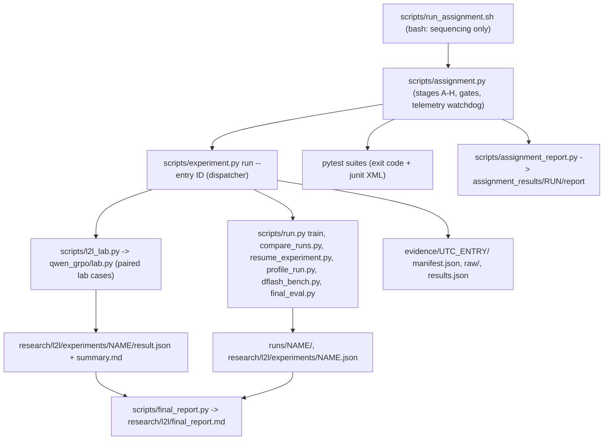

# 13: Orchestration and evidence

**What you will be able to explain after this file**
- How one command (`bash scripts/run_assignment.sh`) turns into stages A–H, which gates stop which stages, and why.
- The four layers of tooling: orchestrator → dispatcher → lab / training tools → derived reports, and which one is allowed to decide what.
- How a lab experiment pairs the L2L candidate with a resident reference, what PASS/FAIL/BLOCKED mean, and how memory evidence is graded.
- Exactly what evidence exists today, on which hardware, and what it does **not** show.
- What "the tests pass" proves and what it does not.

Evidence labels: **[code]**, **[test]**, **[measured]**, **[predicted]**, **[unverified]**.

---

## 1. What the assignment asks for (and what the orchestration is built around)

From the Soup Hard Track v5 PDF (outside the repo, `Soup-Task-01-AI-Engineer-v5.pdf`):
- Qwen/Qwen3-4B, non-thinking, GRPO + LoRA, no SFT, 1–2k prompts, automatic verifiable reward.
- "Training, rollout generation, the merge and the evaluation of the merged model must all stay within 8 GB of GPU memory as shown by nvidia-smi (CUDA context included) … an allocator limit is not a cap until nvidia-smi confirms it."
- L2L with pinned CPU weights, layer-boundary checkpoints, copy/compute overlap on a separate stream; equivalence to a non-L2L reference "within a tolerance you justify".
- Disk streaming with deterministic resume; tensor-by-tensor merge; DFlash rollouts with acceptance length, step time with and without, on-policy proof, drift study.
- A check that tells real learning from "finished without changing" and from reward gaming, with a negative control and CIs.
- A silent-failure audit and a SHIP / DON'T SHIP verdict.

The orchestration's design principle follows from that last line: **a finished run is not evidence**. Every stage records raw output, and the verdict is derived from files, never typed in.

## 2. The four layers

| Layer | File | May decide | May not |
|---|---|---|---|
| Sequencer | `scripts/run_assignment.sh` | order, resume flags, exit code (0 = SHIP) | compute anything ("Bash only sequences") |
| Orchestrator | `scripts/assignment.py` | stage gates, the 8e9 B watchdog verdict on capped stages | compute an experimental result ("It never computes an experimental result itself") |
| Dispatcher | `scripts/experiment.py` + `configs/studies/assignment.yaml` | whether an entry can run here (hardware, prerequisites); reads tool verdicts | edit hypotheses.yaml, override a tolerance |
| Tools | `l2l_lab.py`/`lab.py`, `run.py`, `compare_runs.py`, … | the actual measurements and per-case verdicts | — |

## 3. Stages A–H (`scripts/assignment.py:1-60`, `STAGE_ENTRIES` at :100)

| Stage | Name | Runs | Gate (`gate()`, :1084) |
|---|---|---|---|
| A | preflight | provenance, environment probe, resolved configs, study plan, budget predictions (read-only) | — |
| B | correctness | CPU pytest suites, tiny-model lab cases H01/H02/H04/H05 (sync and async), fault controls, H08 tiny resume, H09 tiny merge | — |
| C | reference_0.6b | `H05.real_0.6b_bf16`, `H06.prefetch_timing`, `H08.resume_qwen3_0.6b`, `H09.merge_qwen3_0.6b` | native-bf16 CUDA GPU with a working stream/event check |
| D | memory_4b | `H11.smoke` (guarded 4B training smoke), `H11.profile` | GPU + host RAM ≥ 32e9 B and disk ≥ 40e9 B |
| E | dflash | `H10.dflash_bench`, `H10.smoke_dflash` | D's `H11.smoke` PASS with memory not FAIL |
| F | training | `H12.train_final` (final run + LR=0 control) | every `ESSENTIAL_B` PASS; `H05.real_0.6b_bf16` PASS (full mode); `H11.smoke` and `H11.profile` PASS with nvidia-smi memory PASS; since the final config uses DFlash, `H10.dflash_bench` and `H10.smoke_dflash` PASS |
| G | evaluation | `H12.final_eval`, `H10.dflash_drift` (checkpoints step0/20/40/60) | F PASS |
| H | audit | Soup's own checks if installed; silent-failure matrix | — |

Key sets:
- `ESSENTIAL_B` (:118): unit tests, sync and async lab cases on this GPU, both `unsafe_reuse` fault controls, tiny resume and merge.
- `FRESH = {B, C}`: re-run under a new evidence name even if an older result exists (old evidence is never trusted for a new run).
- `CAPPED = {D, E, F, G}`: every Qwen3-4B workload runs under `qwen_grpo.telemetry` — raw nvidia-smi every 200 ms, cap **8e9 bytes** (`gpu_memory_cap.bytes` in the study file). "A capped item whose telemetry shows a sample above the cap is FAIL whatever the tool said."
- **Dropped by e8440e4** (comment at :94-99): H03 and H07 entries are not in any stage; the report lists them as NOT_TESTED "dropped from the protocol by design".

Modes:
- `full` (default): A B C D E F G H; the only mode that can produce SHIP.
- `experiment` (`--experiment`): A D B E F G H, no C, reduced B (async lab cases, the unsafe-reuse controls, tiny resume/merge, DFlash unit tests). `H02.fault_unsafe_reuse` is **WAIVED** (:148): F may start without it, and the report lists it as a known limitation. An experiment run never gets SHIP.

Statuses: PASS, FAIL, BLOCKED (gate or capability missing: "never PASS"), INCONCLUSIVE (e.g. diagnostic-only memory evidence for H11, or evidence predating this run that cannot be re-run under a new name), NOT_TESTED.

## 4. The study manifest and judges (`configs/studies/assignment.yaml`)

Each entry: `id` (`H05.real_0.6b_bf16`), evidence `name`, `model` (tiny / Qwen3-0.6B / Qwen3-4B), `precision`, `requires` (`cuda`, `bf16`, `fixture_packages`, `linux_native`, `per_process_smi`), `min_vram_gib`, `prerequisites`, `steps` (argv lists), and a `judge`:

| Judge | Meaning |
|---|---|
| `lab` | the lab result's status / execution_status / hypothesis_result |
| `lab_fault` | a fault control: PASS iff the lab result is `FAIL` with execution `PASS` (the corruption was caught) |
| `pass_key` | a JSON result's boolean `pass` (e.g. resume experiment) |
| `exit_codes` | every step exits 0 (e.g. `compare_runs.py` exits 0 iff runs are identical) |
| `requirements` | statuses derived by `scripts/final_report.py` (e.g. R13) |

`requires: fixture_packages` matters: the saved Ticket 00 fixtures (`research/l2l/fixtures/*.pt`) were built with torch 2.14.1+cu126, transformers 4.57.6, peft 0.21.3, and the lab **refuses** other versions. This workstation has torch 2.14.1+**cu130**, so fixture cases cannot run here at all.

## 5. The lab protocol (`research/l2l/protocol.md`, `qwen_grpo/lab.py`)

- **Pairing.** Each case runs the resident reference and the candidate (the config's `execution` backend) on the same frozen fixture: same weights, LoRA tensors, rollouts, advantages, old log-probs, optimizer settings, dtype, thread count. The reference is recomputed every run and must equal the saved one bitwise ("a drifting reference fails the experiment").
- **Thresholds.** From `tolerances.yaml`, fixed before the acceptance run. Pass iff shapes/dtypes match, finite, and `max|got − ref| ≤ atol + rtol·max|ref|`. Mostly `0` (see [11](11-research-hypotheses.md) §0).
- **Power rules.** Every reference gradient must be non-zero (a zero gradient makes equality meaningless); fault controls must actually fire (`UnsafeReuse.injected`).
- **Performance cases.** Warmup, interleaved trials, median + bootstrap CI of the ratio; no speedup claimed unless the CI excludes 1.
- **Memory evidence grades** (`lab.evidence_grade`):

| Grade | Condition | Can support an 8 GB claim? |
|---|---|---|
| none | no GPU reading | no |
| incomplete | allocator stats or `cudaMemGetInfo` missing | no |
| diagnostic | allocator + `cudaMemGetInfo` | no (e.g. WSL2: nvidia-smi per-process shows `[N/A]`) |
| assignment | plus a numeric per-process nvidia-smi reading, outside WSL2 | **only this** |

On the historical laptop (WSL2) nvidia-smi read 134 MiB while `cudaMemGetInfo` read 857 MiB and the allocator held 22 MiB (`t01_timing_cuda`) — an example of why allocator numbers and WSL2 nvidia-smi are not evidence.

- **Records.** `result.json` + `summary.md` whatever the outcome, never overwritten; commit, dirty flag, package versions, config hash, fixture hashes, tolerance hash.

## 6. How the final verdict is derived

`scripts/final_report.py` maps requirements R1–R15 to named experiment files and derives each status. Current `research/l2l/final_report.md`: **Verdict: DON'T SHIP**.
- PASS: R1 (H01), R2 (H02), R3 (H03), R4 (H04), R5 (H05), R9 (H08, tiny only).
- NOT TESTED: R6 (async exactness), R7 (async speed), R8 (bounded residency), R10 (real merge), R11–R12 (DFlash), R13 (8 GB), R14 (held-out learning), R15 (negative control).
- "Evidence freshness": every PASS row lists engine files changed since that evidence was produced — the evidence predates the current code.

## 7. Evidence inventory (what exists today)

| Evidence | Hardware | What it shows | What it does not show |
|---|---|---|---|
| `t01_*` | CPU; RTX 3050 Ti laptop (WSL2) | resident-vs-resident determinism; timing harness | anything about L2L |
| `t02_store_depth` | RTX 3050 Ti | streamed peak allocated 3,148,800 B at depths 2–32; resident 3.2 → 50.5 MB **[measured]** | execution (copy-only); process-level memory |
| `t02_pinned_transfer` | RTX 3050 Ti | pinned 6.58 vs pageable 4.44 GB/s H2D **[measured]** (literature.md) | target GPU bandwidth |
| `t02_store_equivalence*` | CPU/GPU | store copies bytes exactly; perturbed-weight fault caught | — |
| `t03_forward_equivalence` (+ `wrong_layer` fault) | tiny models | H01 bitwise, 2690 comparisons | real model; async |
| `t04_gradient_equivalence_{cpu,cuda}` (+ `detach_boundary`) | CPU, RTX 3050 Ti | H02 bitwise, 5296 comparisons | async |
| `t05_logprob_equivalence_cpu_v2` (+ `raw_logit_v2`) | CPU | H03 within derived tolerances | GPU; not used in training |
| `t06_generation_equivalence_{cpu,cuda}` (+ 2 faults) | CPU, RTX 3050 Ti | H04 | async; 4B |
| `t07_update_equivalence_{cpu_v2,cuda_v2}` (+ `advantage` fault) | CPU, RTX 3050 Ti | H05 bitwise over 3 AdamW iterations | async |
| `real_step_20261117T063325Z`, `…063548Z` | RTX 3050 Ti (WSL2), Qwen3-0.6B bf16 | two GRPO updates L2L vs resident: old_logp, logp, grads `max_abs 0`, rollouts equal **[measured]** | async; micro-batching (`micro_batch_size: None`) |
| `compare_qwen_resident_vs_qwen_l2l` | RTX 3050 Ti | 100-step 0.6B training resident vs **l2l_sync**: all training rows and 11 evaluations identical **[measured]** | async; 4B |
| `t09_resume_tiny_cpu` (+ `evidence/20261117T175211Z_H08.resume_tiny_cpu`) | CPU | 6 crash points → identical committed trajectory | real model |
| `t10_merge_equivalence_tiny` | CPU | tiny fp32/bf16 merge within half-ulp | real model |
| `research/l2l/corrections/h02_unsafe_reuse_20261118` | CPU | fault refused by `BufferReuseError` 80/80 after the fix | CUDA streams/events |
| `runs/qwen` | RTX 3050 Ti | 0.6B GRPO, lr 5e-4, 100 steps from 142 attempts (42 zero-signal skipped); final full-validation accuracy 0.7486 → 0.5281 with predicted-POSITIVE rate 0.968 (collapse); step90 checkpoint test accuracy 0.7964, +0.0638 vs base, 95% CI [+0.0422, +0.0854] **[measured]** | 4B; lr 2e-4; the final config |
| `results/budget/predictions/*` | none | memory/time **[predicted]** | anything measured |

Note on `runs/qwen`: selecting step 90 because it scored well on validation and then reporting its test accuracy is legitimate (test was not used for selection), but the run *as trained* ended collapsed. The honest summary is "0.6B GRPO at lr 5e-4 is unstable; an intermediate checkpoint generalizes".

**No Qwen3-4B measurement of any kind exists.** No `t08_*` (async) result exists.

## 8. Why there is no 4B evidence: hardware

- The historical CUDA evidence came from an RTX 3050 Ti laptop under WSL2 (diagnostic memory grade at best).
- The current workstation has a Quadro P1000 (sm_61, 4 GB). The installed torch 2.14.1+cu130 has no sm_61 kernels, so every CUDA kernel launch fails; `trainer.check_device` refuses it explicitly (`trainer.py:429-447`). Only CPU tests run locally.
- Kaggle T4/P100 have no native bf16; entries run there are marked `diagnostic: true` (fp32) and never count as hypothesis evidence.
- The target is a rented native-Linux Ampere-or-newer GPU (the assignment's own hardware line), ≥ 32e9 B RAM, ≥ 40e9 B disk.

## 9. What "the tests pass" proves, and what it does not

Proves **[test]**:
- On tiny random Qwen3 models, the L2L code paths give bitwise the same logits, gradients, AdamW states as resident, across many shapes, dtypes, LoRA placements and buffer counts.
- Ownership rules refuse every injected unsafe copy (CPU buffers).
- Resume, merge, DFlash acceptance logic (greedy equality, chi-square) behave as specified on tiny models.

Does not prove:
- CUDA stream/event correctness under real concurrency. On CPU buffers there are no streams: copies are immediate, so a missing `wait_event` cannot show up.
- bf16 numerics at 4B scale, or kernel selection on a different GPU.
- Any timing claim (overlap, DFlash speedup).
- Any memory claim at 4B or under nvidia-smi.
- That GRPO at these hyperparameters learns anything.
- That the current code equals the code that produced the cited evidence (the freshness table says it does not).

## Open questions / unverified

- All CAPPED-stage results (D–G): nothing has run.
- Whether stage B passes fresh on the target GPU with the current code (especially `H01/H02/H04/H05.lab_async_cuda` and the two `unsafe_reuse` controls).
- Whether the 8e9 B watchdog and the 8 GiB in-process guard agree in practice (the watchdog is the binding one).
- Whether the WAIVED status of `H02.fault_unsafe_reuse` should be lifted after a GPU rerun of the corrected code.
- Whether 32e9 B host RAM is enough: the budget predicts ≈ 14.7 GiB at initialization, but it assumes per-tensor pinned rounding (2.2 GiB) that the code avoids with `cudaHostRegister`, and a shard-sized loading copy, while `model.lora_model` loads the whole model on the CPU before the store adopts it **[unverified]**.
