# Whimsical diagrams: 15 specifications

**What you will be able to explain after this file**
- How to redraw the whole system as 15 small, connected diagrams instead of one unreadable one.
- For each diagram: its nodes, labelled edges, swimlanes, tensor annotations and the one idea it should convey.
- Which details must be drawn exactly (they are the ones interviewers probe): buffer hits in backward, no prefetch after the last graph layer, the wrap prefetch, DFlash's full-prompt LM head, and the shared 5×6 chunking.

Every diagram is faithful to the working tree of 2026-11-18. Where a diagram shows a number that is a prediction, the label says **pred.**

---

## Global color legend (use in every diagram)

| Color | Meaning | Examples |
|---|---|---|
| **Blue** | Computation (GPU or CPU kernels) | decoder layer, LM head, AdamW step |
| **Orange** | Memory transfer | H2D slab copy, KV prefix copy, `.cpu()` for records |
| **Red** | Synchronization | `wait_event`, `record`, `BufferReuseError`, INIT_TOL check |
| **Green** | Persistent storage | disk files, pinned CPU slabs, checkpoints |
| **Grey** | Control flow / decisions | loops, gates, "all groups uniform?" |
| **Purple** | Autograd structures | `_CheckpointedLayer` nodes, saved tensors, `.grad` |

Shape conventions: rectangles = operations; cylinders = storage; diamonds = decisions; rounded rectangles = tensors (label: `name [shape] dtype @device`).

Common symbols: B = 5 prompts, G = 6, N = 30 rows, P = padded prompt width (51–93 in the first 60 batches, measured with the tokenizer), R ≤ 4 response columns, T = P + R, H = 2560, V = 151,936, L = 36 layers, n = 6 rows per micro-batch.

---

## 1. Complete system architecture

**A. Title.** Qwen3-4B GRPO + LoRA on an L2L engine
**B. Type.** Architecture diagram
**C. Nodes.** Disk (prompts.jsonl, rollouts/, checkpoints/) · CPU RAM: WeightStore (36 pinned slabs, 6.77 GiB) · GPU resident: embedding = tied LM head (741.9 MiB), final norm, LoRA A/B + grads + AdamW (≈ 16 MiB), DFlash drafter (≈ 1.0 GiB), 2 weight buffers (2 × 192.5 MiB), KV cache · Trainer loop · Backend (L2LBackend) · Executor (PrefetchingCheckpointedExecutor) · DFlashGenerator · StreamedGenerator (greedy eval) · GRPO math (training.py, grpo.py) · AdamW
**D. Edges.**
- Disk → Trainer: "5 records / attempt"
- Trainer → DFlashGenerator: "rollouts (sampling)"
- Trainer → StreamedGenerator: "eval (greedy)"
- DFlashGenerator → Executor: "target passes"
- StreamedGenerator → Executor: "decode steps"
- GRPO math → Executor: "teacher-forced logp (via backend.logprobs)"
- WeightStore → weight buffers: "H2D slab copy (copy stream)"
- Executor → weight buffers: "bind params to views"
- GRPO math → AdamW: "LoRA .grad"
- AdamW → LoRA: "in-place update"
- Trainer → Disk: "rollout record, checkpoint + COMMIT.json"
**E. Swimlanes.** Disk | CPU RAM | GPU resident | GPU streamed | Python control
**F. Tensor annotations.** slab i `uint8 [201,861,632] @cpu pinned`; buffer `uint8 [201,861,632] @cuda`; embedding `bf16 [151936, 2560] @cuda`; LoRA A/B fp32 @cuda.
**G. Legend.** Global.
**H. Explanation.** Only two decoder layers' weights are ever on the GPU. Everything trainable is on the GPU and never moves. The CPU store is read-only during training; nothing flows back to the host except records and checkpoints.

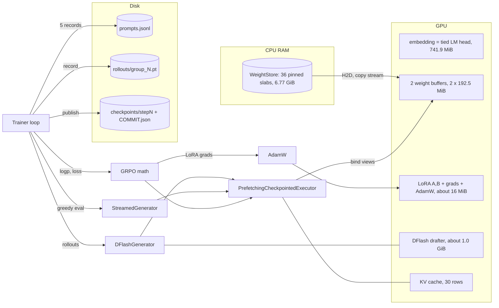

---

## 2. Dataset → batch → groups → micro-batches

**A. Title.** From the pool to five micro-batches of six
**B. Type.** Flowchart
**C. Nodes.** Rotten Tomatoes splits (data/sentiment.json: 1500/1066/1066) · balanced_subset(1024, seed 42) · prompts.jsonl + offsets · PromptStream epoch permutation (Random(42)) · next_batch → 5 records · build_prompts + tokenizer · input_ids [5, P] · repeat_interleave(6) → [30, P] · generation → [30, T] · rewards [5, 6] · adv [30] · micro_batches(6): rows 0–5, 6–11, 12–17, 18–23, 24–29 · prepare (no grad) · grpo_update (grad) · one AdamW step
**D. Edges.** pool → stream: "write once, sha256"; stream → batch: "5 by offset"; batch → ids: "chat template, left pad"; ids → [30,P]: "repeat_interleave(6)"; [30,T] → rewards: "decode + exact label"; rewards → adv: "group mean/std"; [30,T] → chunks: "slice rows, same P and T"; chunks → prepare: "old_logp [30,R]"; chunks → update: "same 5 chunks"; update → AdamW: "after chunk 5"
**E. Swimlanes.** Disk | CPU | GPU
**F. Annotations.** `input_ids [5,P] int64 @cuda`; `sequences [30,T] int64 @cuda`; `rewards [5,6] fp32 @cpu`; `adv [30] fp32 @cuda`; `old_logp [30,R] fp32 @cuda`.
**G. Legend.** Global.
**H. Explanation.** Four different "batch sizes": rollout batch (30 rows, generated together), group (6 rows of one prompt, share a baseline), micro-batch (6 rows, a memory unit only — it happens to equal G, but rows 0–5 are a group only because both are 6), and optimizer batch (all 30: one AdamW step). Batch 205 straddles the epoch boundary (1024/5 = 204.8).

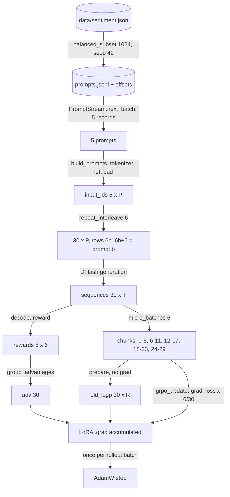

---

## 3. GRPO rollout generation

**A. Title.** Five prompts become thirty sampled completions
**B. Type.** Flowchart
**C. Nodes.** prompts [5,P] · repeat_interleave → [30,P] · KVCache alloc (36 × K,V [30, 8, P+20, 128] bf16) · prefill (36 layers, all P columns) · first token draw · DFlash rounds · EOS → pad, unfinished mask · stop (4 tokens or all EOS) · response_mask · rollouts dict
**D. Edges.** prefill → draw: "fp32 logits, last column, multinomial"; draw → rounds: "block of 4"; rounds → rounds: "until R = 4 or all EOS"; stop → response_mask: "up to and including first EOS"; response_mask → attention_mask: "concat prompt mask"
**E. Swimlanes.** GPU compute | GPU transfer
**F. Annotations.** `sequences [30, P+R] int64`; `completion_mask [30, R] bool`; `attention_mask [30, T] int64`.
**G. Legend.** Global.
**H. Explanation.** All 30 rows are generated simultaneously. What is shared across a group: nothing at runtime — the prompt is duplicated 6× before prefill, including its KV. What differs: the sampled tokens (one global RNG stream, temperature 1, no top-k/top-p). A finished row keeps receiving the pad id (`<|endoftext|>`, also an EOS id), which is why the mask is built from positions, not from `ids != pad`.

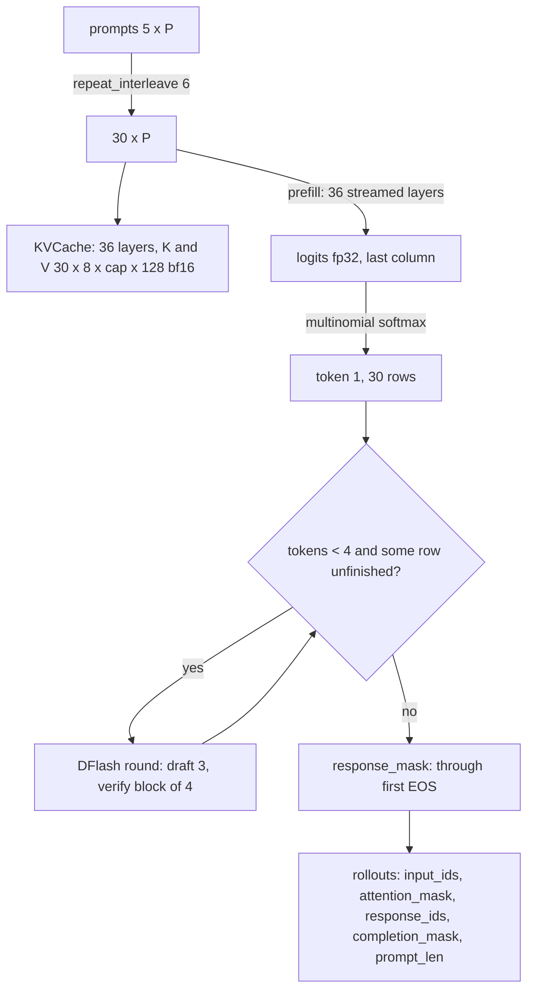

---

## 4. Qwen3 forward propagation (one decoder layer)

**A. Title.** One Qwen3-4B decoder layer
**B. Type.** Flowchart with tensor shapes
**C. Nodes.** h_in [n,T,2560] · input_layernorm (RMSNorm) · q_proj (+LoRA) → [n,T,4096] · k_proj → [n,T,1024] · v_proj (+LoRA) → [n,T,1024] · reshape to heads q [n,32,T,128], k,v [n,8,T,128] · q_norm, k_norm (per-head RMSNorm) · RoPE (cos, sin [n,T,128]) · GQA: repeat k,v ×4 · SDPA with mask [n,1,T,T] · o_proj (+LoRA) → [n,T,2560] · residual add · post_attention_layernorm · gate_proj, up_proj → [n,T,9728] · SiLU(gate) ⊙ up · down_proj → [n,T,2560] · residual add · h_out
**D. Edges.** labelled with shapes as above; "LoRA only in layers 34, 35".
**E. Swimlanes.** none (single GPU stream)
**F. Annotations.** weights bf16 views of a streaming buffer; LoRA fp32; activations bf16.
**G. Legend.** Blue for ops, purple for LoRA branches.
**H. Explanation.** Every frozen weight here is a view into a 192.5 MiB GPU buffer for the duration of the call. Outside the layer loop: embedding lookup before layer 0, final RMSNorm and LM head (tied to the embedding) after layer 35. Positions for left-padded rows: `cumsum(mask) − 1`.

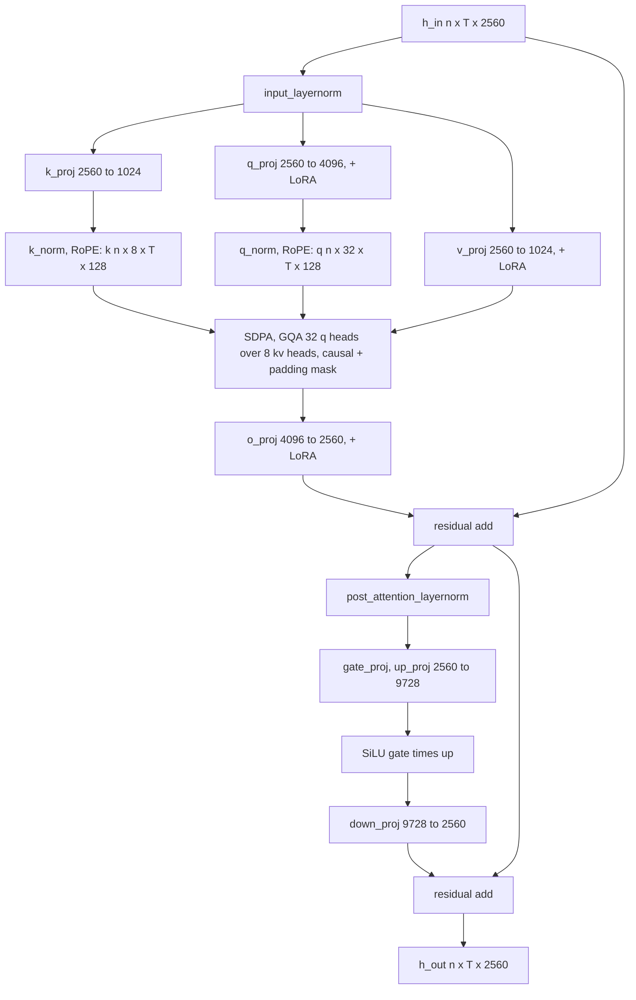

---

## 5. L2L synchronous weight streaming

**A. Title.** l2l_sync: copy, bind, compute, unbind
**B. Type.** Sequence diagram
**C. Participants.** explicit_forward loop · StreamingLayerExecutor · WeightStore (pinned slab i) · GPU buffer i mod 2 · HF/PEFT layer i
**D. Messages.** loop → executor: "execute(i, h)"; executor → store: "copy_to(i, buffer)"; store → buffer: "copy_ 192.5 MiB + synchronize"; executor → layer: "re-point Parameter.data to buffer views; check inside buffer"; layer → executor: "h_out (new tensor, not in buffer)"; executor → layer: "re-point back to CPU slab views (finally)"
**E. Swimlanes.** CPU | GPU (single stream)
**F. Annotations.** Views: `{name: buffer[offset:offset+nbytes].view(bf16).view(shape)}`; offsets multiples of 256 B.
**G. Legend.** Orange for the copy, red for synchronize.
**H. Explanation.** Safe by construction: one stream, and `copy_to` synchronizes after each copy, so a buffer can never be overwritten while read. Slow by construction: copy and compute never overlap. Forward-only: refuses grad mode.

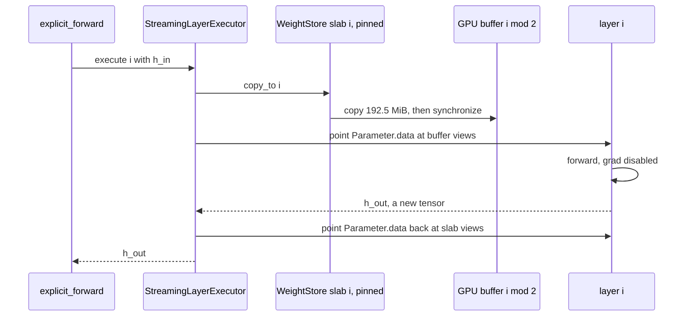

---

## 6. L2L asynchronous prefetching with two buffers

**A. Title.** Layer i computes while layer i+1 is copied
**B. Type.** Sequence diagram (three lanes)
**C. Participants.** Host (Python) · Transfer stream · Compute stream · Buffer A / Buffer B
**D. Messages (no-grad pass, steady state).**
- Host: `_acquire(i)`: slot of i found (hit) → `_prefetch(i+1)`: victim = LRU slot ≠ current → `_claim` OK → transfer.wait_event(victim.free) → copy slab i+1 → victim.ready.record
- Host: compute.wait_event(slot_i.ready) → enqueue layer i kernels
- Host: `_release(i)`: slot_i.free.record on compute stream
- At layer 35 in a no-grad pass: prefetch wraps to layer 0 (next decode step / micro-batch)
- At layer 35 in a grad pass: no prefetch
**E. Swimlanes.** Host | Transfer stream | Compute stream
**F. Annotations.** each copy 201,861,632 B pinned → GPU.
**G. Legend.** Orange copies, blue compute, red waits/records.
**H. Explanation.** Overlap is real only if the source is pinned, a copy engine is free, and compute(i) lasts at least as long as copy(i+1). For 30-row decode steps compute is short, so the pass is transfer-bound. The host never synchronizes; ordering is GPU-side via events.

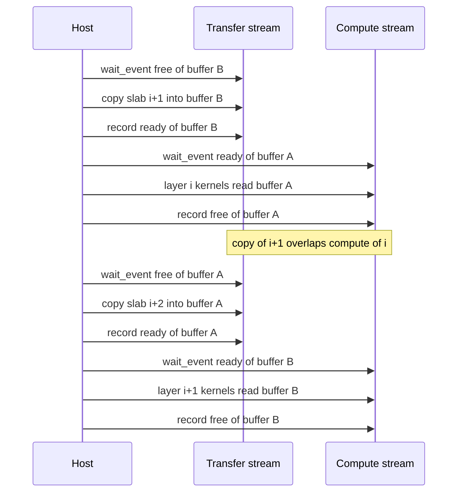

Companion table (draw beside it): buffer contents over one micro-batch of the update pass, 36 layers, 2 buffers.

| Time | Compute | Buffer A | Buffer B | Copy issued |
|---|---|---|---|---|
| fwd L0 | L0 | L0 (in use) | — | L1 → B |
| fwd L1 | L1 | L0 → free | L1 (in use) | L2 → A |
| … | … | even layers | odd layers | … |
| fwd L34 | L34 | L34 (in use) | L33 → L35 | L35 → B |
| fwd L35 | L35 | L34 | L35 (in use) | **none (grad pass)** |
| bwd L35 | recompute 35 | L34 | L35 (hit) | none (34 resident) |
| bwd L34 | recompute 34 | L34 (hit) | L35 → free | **L0 → B (next chunk)** |

---

## 7. Stream/event synchronization and buffer ownership

**A. Title.** Life of a Slot
**B. Type.** State machine
**C. States.** Empty · Copying (copy enqueued, `ready` pending) · Ready (copy done, not yet bound) · InUse (bound; `_in_use = slot`) · Released (`free` recorded, `last_use` set) · Refused (`BufferReuseError`)
**D. Transitions.**
- Empty → Copying: "_copy(j): _claim OK; transfer.record(ready)"
- Copying → Ready: "ready event completes on GPU"
- Ready → InUse: "_acquire(j): compute.wait_event(ready)"
- InUse → Released: "_release: free.record on compute"
- Released → Copying: "_copy(k): transfer.wait_event(free) first (R1)"
- Released → InUse: "hit: same layer used again (e.g. backward)"
- InUse → Refused: "copy targets the slot in use (R3)"
- Ready → Refused: "copy targets a slot of the prefetch window (R3)"
- Released → Refused: "used slot with free = None (R1, CUDA)"
**E. Swimlanes.** none
**F. Annotations.** `Slot(buffer, index, ready, free, last_use)`.
**G. Legend.** Red for refused, green for ready.
**H. Explanation.** R1–R4 are the only synchronization. `_claim` is host-side bookkeeping: it costs no GPU sync and runs always, not only in verify mode. It was added after H02 showed that the slot-selection policy alone was not a guarantee.

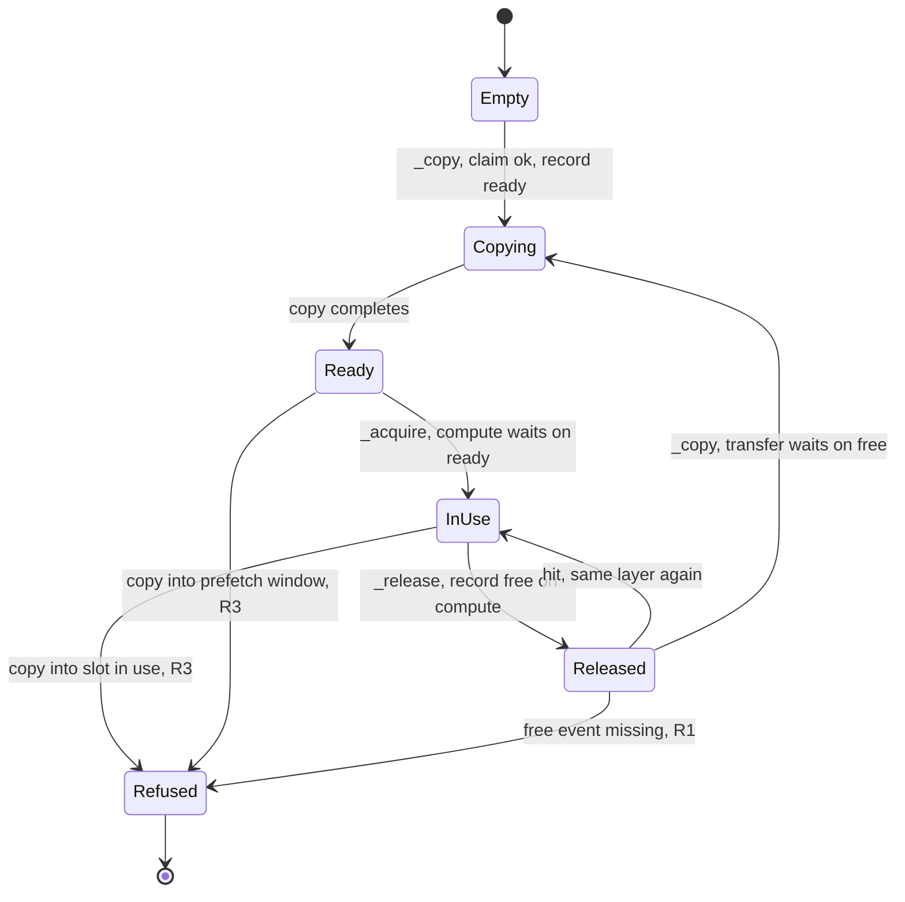

---

## 8. Checkpointed backward

**A. Title.** Backward through two checkpointed layers
**B. Type.** Sequence diagram
**C. Participants.** Autograd engine · LM head + log_softmax nodes · Node 35 (`_CheckpointedLayer`) · Node 34 · Executor + buffers · LoRA leaves
**D. Messages.** loss.backward → head: "dL/dlogp"; head → node35: "g36 = dL/dh36 [n,T,2560]"; node35 → executor: "bound(35, backward): hit"; node35: "recompute layer 35 from saved h35 with grad; checksum == forward"; node35 → LoRA35: "autograd.grad → dL/dA, dL/dB accumulate into .grad"; node35 → node34: "g35 = dL/dh35"; node34 → executor: "bound(34): hit; prefetch L0 for next chunk"; node34 → LoRA34: "grads"; node34: "need_h False: stop (h34 does not require grad)"
**E. Swimlanes.** Autograd | GPU compute | GPU transfer
**F. Annotations.** saved: h34, h35 `[6, T, 2560] bf16`; checksum int64 scalar per node.
**G. Legend.** Purple autograd, blue recompute, red checksum.
**H. Explanation.** Layers 0–33 created no nodes, so backward ends at node 34. Frozen weights are read during backward (every Jacobian contains Wᵀ) but receive no gradient. With two buffers both layers are still resident, so backward costs zero copies.

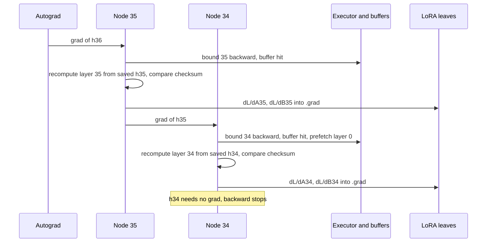

---

## 9. Micro-batch gradient accumulation

**A. Title.** Five chunks, one gradient, one step
**B. Type.** Flowchart (loop)
**C. Nodes.** zero_grad(set_to_none) · chunk c (rows 6c…6c+5) · forward → logp [6,R] · INIT_TOL check vs old_logp[rows] · grpo_loss · × 6/30 · backward (frees graph) · .grad += · c < 5? · grad norms finite? · clip_stats · AdamW.step · zero_grad
**D. Edges.** loop edge "next chunk"; failure edges "RuntimeError, zero_grad, no step".
**E. Swimlanes.** GPU compute | Autograd | Optimizer
**F. Annotations.** LoRA .grad fp32, 1,081,344 elements.
**G. Legend.** Global.
**H. Explanation.** Σ_c (6/30)·(−(1/6) Σ_{i∈c} J_i) = −(1/30) Σ_i J_i: the accumulated gradient equals the full-batch gradient. Only one chunk's graph exists at a time.

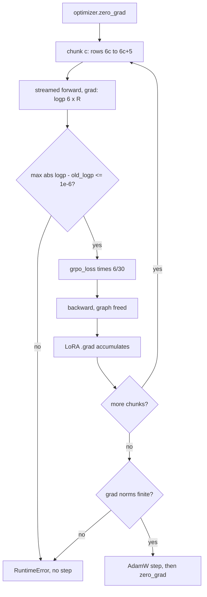

---

## 10. Complete GRPO optimizer update (one attempt)

**A. Title.** One attempt of trainer._train
**B. Type.** Flowchart
**C. Nodes.** next_batch · build_prompts · generate_rollouts (DFlash) · check_grouping · decode · group_rewards [5,6] · all uniform? · prepare (adv, old_logp) · RolloutStore.write · grpo_update · step += 1 · log row · step % 20 == 0? · eval_subset + publish checkpoint
**D. Edges.** uniform → "record zero_signal, continue"; else → update.
**E. Swimlanes.** Disk | CPU | GPU
**F. Annotations.** record `group_000NNN.pt` with CPU tensors and sha256.
**G. Legend.** Global.
**H. Explanation.** The rollout record is written before any update uses it, so a resumed run can verify what it trains on. Zero-signal attempts consume prompts (no retry).

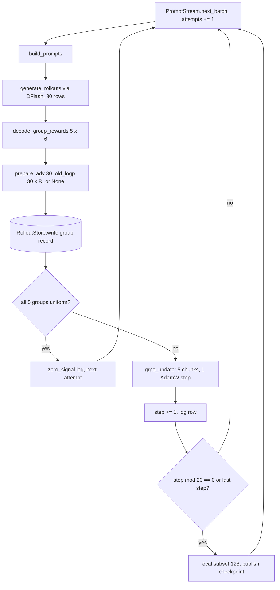

---

## 11. DFlash draft-and-verify

**A. Title.** One DFlash rollout with at most 4 new tokens
**B. Type.** Sequence diagram
**C. Participants.** dflash_generate · Target via executor (streamed) · Drafter (resident) · KVCache
**D. Messages.**
- prefill: target over [30, P], features of layers 1, 9, 17, 25, 33 → [30, P, 12800]; **LM head over all P columns** → fp32 [30, P, V]; draw token 1 from the last column
- round: block = [tok1, mask×3]; drafter(features, block) → 3 drafts (target embedding + target LM head argmax)
- target verifies block [30, 4] in one sweep → y [30, 4], new features
- match = common prefix per row; m = min over unfinished rows; emit drafts[:m] + y_m
- crop KV to committed length − 1; next context = features of committed block positions
- stop at 4 tokens or all EOS
**E. Swimlanes.** GPU compute (resident) | GPU compute (streamed target) | GPU transfer
**F. Annotations.** KV capacity P + 4 + 16; prefill logits ≈ 2.0 GB at P = 73 **pred.**
**G. Legend.** Global.
**H. Explanation.** DFlash ends where `generate_rollouts` returns `input_ids [30, T]`; from there on (rewards, old_logp, loss) nothing knows DFlash existed. Best case 2 target sweeps instead of 3 for "POSITIVE<|im_end|>".

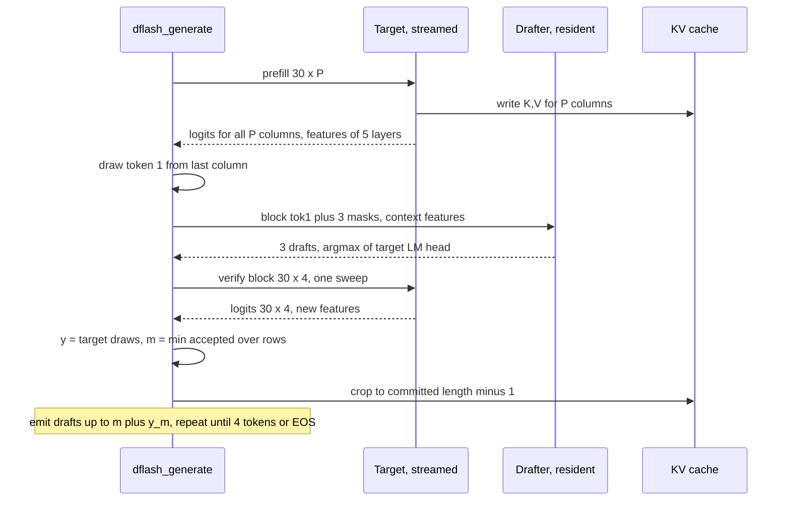

---

## 12. CPU/GPU memory allocation and tensor lifetimes

**A. Title.** Memory over one GRPO step (pred.)
**B. Type.** Memory timeline (Gantt-like bars)
**C. Rows (persistent).** pinned slabs 6.77 GiB (CPU, whole run) · embedding 741.9 MiB · 2 buffers 385 MiB · drafter ≈ 1.0 GiB · LoRA + AdamW ≈ 12 MiB · CUDA context ≈ 0.5 GiB (assumed)
**Rows (transient).** KV cache (rollout only) ≈ 0.34–0.5 GB · prefill logits bf16+fp32 ≈ 2.0 GB (prefill only) · DFlash features · old_logp, adv (until update ends) · per-chunk activations + logits [6, R+1, V] fp32 18 MB · saved h34, h35 · LoRA grads 4.1 MiB (forward of chunk 1 until zero_grad)
**D. Edges.** none (time axis)
**E. Lanes.** CPU | GPU persistent | GPU transient
**F. Phases on the x-axis.** init · rollout prefill · DFlash rounds · old log-probs (5 chunks) · update forward/backward (5 chunks) · AdamW · eval (every 20) · checkpoint
**G. Legend.** Green persistent, orange transient.
**H. Explanation.** Predicted GPU peak is the DFlash prefill (≈ 5.3 GiB allocated, 6.36 GiB device incl. context and 10% margin), not training (≈ 2.3 GiB allocated). None measured.

```mermaid
gantt
  title Predicted GPU residency over one step, not measured
  dateFormat X
  axisFormat %s
  section Persistent
  embedding and buffers and drafter and LoRA   :0, 10
  section Rollout
  KV cache                                     :0, 3
  prefill logits bf16 and fp32                 :0, 1
  section Training
  old_logp and adv                             :3, 8
  chunk activations and logits                 :3, 8
  LoRA grads                                   :5, 8
  section Eval
  greedy KV cache, every 20 steps              :8, 10
```

---

## 13. Disk streaming and deterministic resume

**A. Title.** Commit points and resume
**B. Type.** Flowchart + state machine
**C. Nodes.** prompts.jsonl (sha256, offsets) · sampler state (epoch, position, batches, epoch_rng, order_sha256) · rollouts/group_N.pt + index.jsonl · checkpoint tmp dir · COMMIT.json · atomic rename · crash points (prompt_read, rollouts_generated, update, files_written, committed_before_rename, after_checkpoint) · resume: prepare() (remove .tmp, quarantine invalid) · latest_valid · restore adapter, AdamW, sampler, RNG · discard_after(attempts) → orphaned/
**D. Edges.** "fsync + rename" on every publish; "RNG restored last".
**E. Swimlanes.** Disk | Trainer
**F. Annotations.** training_state.pt: optimizer state dict, step, attempts, log, RNG (torch CPU, CUDA, python).
**G. Legend.** Green storage, red commit.
**H. Explanation.** An update is committed only when a checkpoint containing it is published. Everything after the last commit (records, in-memory updates) is discarded and regenerated identically from the restored RNG and sampler.

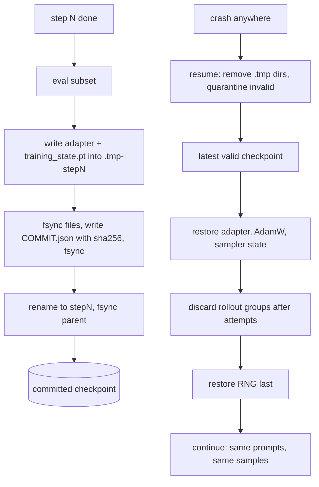

---

## 14. Experimental orchestration

**A. Title.** run_assignment.sh stages A–H
**B. Type.** Flowchart with gates
**C. Nodes.** A preflight · B correctness · C 0.6B reference · D 4B memory · E DFlash · F training · G evaluation · H audit · report / verdict
**D. Edges.** A → B; B → C ("GPU gate"); C → D ("GPU, RAM ≥ 32e9, disk ≥ 40e9"); D → E ("H11.smoke PASS"); E → F ("ESSENTIAL_B, H05.real, H11 x2 memory PASS, H10 x2 PASS"); F → G ("H12.train_final PASS"); G → H; all → report.
**E. Swimlanes.** CPU-only | GPU uncapped | GPU capped at 8e9 B (D–G)
**F. Annotations.** telemetry: nvidia-smi every 200 ms.
**G. Legend.** Grey gates, red cap.
**H. Explanation.** Experiment mode runs A D B E F G H with a reduced B and waives `H02.fault_unsafe_reuse`; it can never yield SHIP.

```mermaid
flowchart LR
  A["A preflight"] --> B["B correctness"]
  B --> C["C Qwen3-0.6B reference"]
  C -->|"GPU, RAM, disk"| D["D 4B memory: H11.smoke, H11.profile"]
  D -->|"H11.smoke PASS"| E["E DFlash: bench, smoke"]
  E -->|"essential B, H05.real, D and E memory PASS"| F["F train final + LR=0"]
  F -->|"H12.train_final PASS"| G["G held-out eval, DFlash drift"]
  G --> H["H audit"]
  H --> V["report and verdict"]
```

---

## 15. Research hypotheses and dependencies

**A. Title.** H01–H12
**B. Type.** Dependency graph
**C. Nodes.** H01 … H12 with status badges: SUPPORTED (H01, H02, H04, H05, H08), SUPPORTED-dropped (H03, H07 Ticket 02 only), untested (H06, H09, H10, H11, H12)
**D. Edges.** as in [11-research-hypotheses.md](11-research-hypotheses.md).
**E. Swimlanes.** Correctness | Performance/memory | Scientific validity
**F. Annotations.** evidence names under each node.
**G. Legend.** Green supported, grey dropped, white untested.
**H. Explanation.** Everything 4B (H10, H11, H12) is untested, and the async variants of H01–H05 have no GPU evidence.

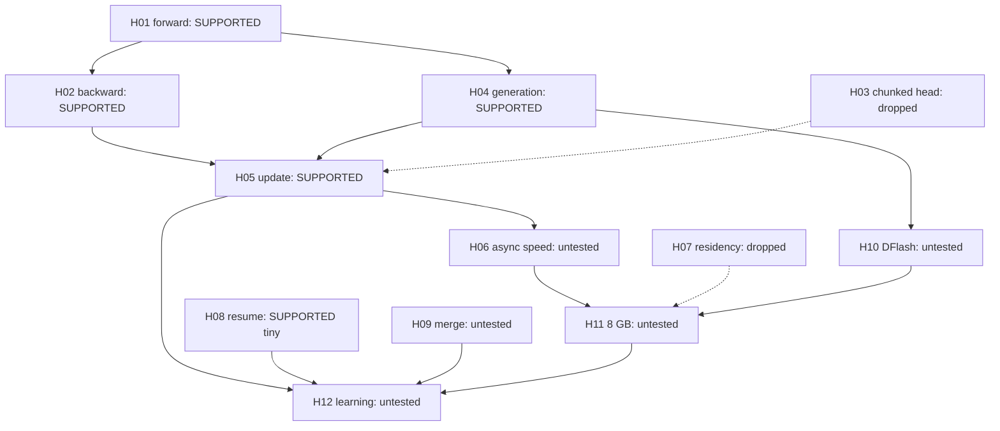
